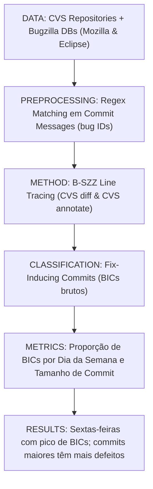

# Ficha Estruturada de Pesquisa Científica — ALGORITMO 01: B-SZZ (Base SZZ)

---

## 1. Identificação

* **Título**: When Do Changes Induce Fixes? (On Fridays.)
* **Autores**: Jacek Śliwerski, Thomas Zimmermann, Andreas Zeller
* **Afiliações**: Department of Computer Science, Saarland University (Saarbrücken, Alemanha)
* **Ano**: 2005
* **Venue**: Proceedings of the 2005 International Workshop on Mining Software Repositories (MSR 2005), ACM, pp. 24–28
* **DOI**: https://doi.org/10.1145/1083142.1083147
* **URL (Paper)**: [01-bszz-msr2005.pdf](file:///home/artur-carvalho/mestrado/papers/01-bszz-msr2005.pdf) / [01-bszz-msr2005.txt](file:///home/artur-carvalho/mestrado/papers/01-bszz-msr2005.txt)
* **Identificação no Estudo**: **ALGORITMO 01 (B-SZZ)**
* **Implementação Local**: [repos/01-bszz/](file:///home/artur-carvalho/mestrado/repos/01-bszz/) / [run_bszz.py](file:///home/artur-carvalho/mestrado/repos/01-bszz/run_bszz.py)

---

## 2. Problema

* **Problema Científico**:
  Como identificar e rastrear sistematicamente a origem temporal e autoral dos defeitos de software, conectando o momento em que um bug é corrigido no repositório de controle de versão (CVS) ao momento exato em que ele foi originariamente introduzido no código-fonte.
* **Limitações Anteriores**:
  1. *Desconexão entre Sistemas*: Repositórios de código (CVS/SVN) e rastreadores de bugs (Bugzilla) operavam como silos isolados sem rastreabilidade automática de causa-efeito.
  2. *Auditoria Retrospectiva Inviável*: Não existia método determinístico para apontar quais commits do passado causaram falhas futuras sem inspeção manual exaustiva de logs.
  3. *Métricas de Risco Baseadas em Suposições*: Práticas de engenharia não dispunham de dados empíricos para validar hipóteses sobre dias de pico de introdução de bugs ou correlação entre tamanho de mudança e risco.

---

## 3. Perguntas de Pesquisa (Research Questions)

* **RQ1**: É possível reconstruir automaticamente a linhagem evolutiva de um bug correlacionando anotações de commits de correção com logs de linhas modificadas no histórico de versão?
* **RQ2**: Quando mudanças indutoras de correções (*fix-inducing changes*) são introduzidas? Existe dependência temporal com o dia da semana em que o desenvolvedor submete a alteração?
* **RQ3**: Qual a relação empírica entre o tamanho da transação/commit e a probabilidade de induzir defeitos subsequentes?

---

## 4. Hipóteses

* **Hipótese 1 [FATO DOCUMENTADO - Seção 1]**: Se uma linha de código foi removida ou modificada durante um commit de correção de bug (*bug-fixing change*), a última versão que alterou aquela mesma linha antes do fix é a candidata primordial a ter introduzido o erro.
* **Hipótese 2 [FATO DOCUMENTADO - Seção 4]**: Mudanças submetidas em dias específicos (especialmente sextas-feiras e finais de semana) têm taxa estatisticamente superior de introduzir bugs devido à fadiga de final de ciclo e pressa para encerramento de sprints.

---

## 5. Objetivos

* **Objetivo Geral**:
  Formalizar a mecânica fundacional do algoritmo SZZ (*Śliwerski-Zimmermann-Zeller*), estabelecendo o pipeline pioneiro de ligação entre Bug Tracker e `diff/blame` de repositório.
* **Objetivos Específicos**:
  1. Definir o algoritmo para identificar transações de correção (*fix commits*) via parsing de regex em mensagens de commit (`bug`, `fix`, `show_bug.cgi?id=`).
  2. Usar `cvs diff` e `cvs annotate` (equivalente ao moderno `git blame`) para rastrear as linhas apagadas/alteradas até o commit anterior.
  3. Executar o pipeline sobre grandes repositórios históricos de software livre (Mozilla e Eclipse).
  4. Extrair padrões temporais e volumétricos das mudanças causadoras de bugs.

---

## 6. Metodologia

* **Detecção de Fix Commits**: Extração de transações que referenciam IDs válidos do Bugzilla com status CLOSED/RESOLVED/FIXED.
* **Rastreamento de Linhas**: Para cada arquivo modificado no fix, compara a versão $V_{curr}$ com $V_{curr-1}$. Para cada linha deletada ou substituída, invoca `annotate` em $V_{curr-1}$ para identificar a revisão que introduziu essa linha.
* **Atribuição Indutora**: Todos os commits retornados pelo `annotate` para as linhas modificadas são marcados como Fix-Inducing.

---

## 7. Datasets / Dados Utilizados

* **Mozilla**: Repositório CVS contendo histórico entre 1998 e 2004;
* **Eclipse**: Repositório CVS do Eclipse SDK cobrindo o período de 2001 a 2004.
* Total de centenas de milhares de linhas e milhares de relatórios de bugs do Bugzilla integrados pioneiramente.

---

## 8. Principais Resultados e Descobertas

1. **Padrão das Sextas-Feiras**: No Eclipse, sextas-feiras apresentaram probabilidade substancialmente maior de commit indutor em relação a terças e quartas-feiras.
2. **Impacto do Tamanho da Mudança**: Commits grandes (tocando múltiplos arquivos e dezenas de linhas) induzem exponencialmente mais correções do que micro-commits.
3. **Ponto Crítico de Falso Positivo (Limitação do B-SZZ)**: Como o B-SZZ não filtra linhas em branco, comentários ou renomeações sintáticas, qualquer commit cosmético que tocou uma linha é erroneamente acusado como culpado pelo bug (*mislabeled BIC*).

---

## 9. Ameaças à Validade

* **Validade Interna**: O B-SZZ ingênuo trata toda linha alterada como defeituosa; se um desenvolvedor apenas formatou a indentação de uma linha com bug, o B-SZZ acusa o formatador e não o autor do bug.
* **Validade de Construção**: Heurísticas baseadas em palavras-chave (`bug`, `patch`) em mensagens de commit geram falsas vinculações com bugs não relacionados.
* **Validade Externa**: Análise limitada a 2 sistemas (Mozilla e Eclipse) em CVS pré-Git.

---

## 10. Métricas e Fórmulas

* **Taxa de Indução por Dia**:
  $$\text{Risk}(Day) = \frac{\sum \text{BICs submetidos no dia } Day}{\sum \text{Commits totais no dia } Day}$$
* **Conjunto de BICs Candidatos**:
  $$\text{BIC}(C_{fix}) = \bigcup_{l \in \text{DeletedLines}(C_{fix})} \text{Annotate}(l, \text{Parent}(C_{fix}))$$

---

## 11. Relação com a Família SZZ

* **B-SZZ** é o ancestral comum de toda a literatura.
* Todas as variantes posteriores nasceram para corrigir as fraquezas do B-SZZ:
  - **AG-SZZ** (Kim et al., 2006): Introduz remoção de linhas em branco e comentários.
  - **MA-SZZ** (da Costa et al., 2017): Introduz janelas temporais e auditoria de commits suspeitos.
  - **L-SZZ** (Rosa et al., 2021): Adiciona análise de AST com srcML.
  - **RA-SZZ** (Fan et al., 2021): Adiciona RefactoringMiner para desconsiderar refatorações.
  - **LLM-SZZ / LLM4SZZ / AgentSZZ**: Substituem a busca sintática ingênua por raciocínio semântico contextual.

---

## 12. Aplicação Prática no Benchmark Flink

* Execução do script `repos/01-bszz/run_bszz.py` consumindo `repos/00-flink/extracted_fixes/flink_bugfix_commits.json`.
* Serve como **baseline inferior heurístico**: estabelece o limite de ruído máximo e sobreinclusão de falsos positivos na base unificada Apache Flink.

---

## 13. Referências Bibliográficas

* Jacek Śliwerski, Thomas Zimmermann, Andreas Zeller. "When Do Changes Induce Fixes?". In *Proc. MSR 2005*, pp. 24–28, ACM, 2005. DOI: [10.1145/1083142.1083147](https://doi.org/10.1145/1083142.1083147).
