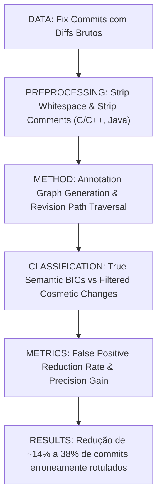

# Ficha Estruturada de Pesquisa Científica — ALGORITMO 02: AG-SZZ (Annotation Graph SZZ)

---

## 1. Identificação

* **Título**: Automatic Identification of Bug-Introducing Changes
* **Autores**: Sunghun Kim, Thomas Zimmermann, Kai Pan, E. James Whitehead Jr.
* **Afiliações**: University of California, Santa Cruz (EUA); Saarland University (Alemanha)
* **Ano**: 2006
* **Venue**: Proceedings of the 21st IEEE/ACM International Conference on Automated Software Engineering (ASE 2006), pp. 81–90
* **DOI**: https://doi.org/10.1145/1169301.1169316
* **URL (Paper)**: [02-agszz-ase2006.pdf](file:///home/artur-carvalho/mestrado/papers/02-agszz-ase2006.pdf) / [02-agszz-ase2006.txt](file:///home/artur-carvalho/mestrado/papers/02-agszz-ase2006.txt)
* **Identificação no Estudo**: **ALGORITMO 02 (AG-SZZ)**
* **Implementação Local**: [repos/02-agszz/](file:///home/artur-carvalho/mestrado/repos/02-agszz/) / [run_agszz.py](file:///home/artur-carvalho/mestrado/repos/02-agszz/run_agszz.py)

---

## 2. Problema

* **Problema Científico**:
  O algoritmo B-SZZ original gera um volume excessivo de falsos positivos (*false positives / mislabeled changes*) porque considera cegamente qualquer alteração textual em uma linha como indutora do bug, mesmo quando a alteração foi meramente cosmética (espaços em branco, quebra de linha, comentários) ou quando a modificação era trivial.
* **Causas Raízes Identificadas**:
  1. *Mudanças Não-Executáveis*: Linhas contendo apenas comentários ou espaçamentos/indentação eram rastreadas pelo `annotate/blame` e culpadas pelo bug.
  2. *Falta de Rastreamento de Linhagem Fina*: Sem um grafo de anotações (*annotation graph*), renomeações e movimentações de código quebravam a atribuição causal.
  3. *Impacto Tóxico em Modelos Preditivos*: Modelos de predição de defeitos treinados com dados ruidosos do B-SZZ sofriam degradação severa de acurácia.

---

## 3. Perguntas de Pesquisa (Research Questions)

* **RQ1**: Como eliminar eficientemente mudanças cosméticas e comentários do rastreamento de linhas para reduzir falsos positivos na identificação de BICs?
* **RQ2**: A introdução de um Grafo de Anotações (*Annotation Graph*) e algoritmos de diff sintático melhora a acurácia de identificação de commits indutores em comparação ao B-SZZ?
* **RQ3**: Qual o ganho percentual na pureza dos conjuntos de dados de treinamento para modelos de predição de defeitos ao aplicar os filtros do AG-SZZ?

---

## 4. Hipóteses

* **Hipótese 1 [FATO DOCUMENTADO - Seção 3]**: Linhas que sofreram apenas modificações em comentários ou em caracteres de espaçamento/formatação (*whitespace*) nunca introduzem erros lógicos funcionais de software.
* **Hipótese 2 [FATO DOCUMENTADO - Seção 4]**: Rastrear a evolução de linhas através de um grafo que conecta instâncias de linhas entre revisões permite ignorar revisões intermediárias que não alteraram a semântica da linha.

---

## 5. Objetivos

* **Objetivo Geral**:
  Desenvolver o algoritmo AG-SZZ (*Annotation Graph SZZ*), incorporando pré-processamento de código e filtragem estrita de mudanças cosméticas antes do rastreamento por grafo de revisões.
* **Objetivos Específicos**:
  1. Construir filtros automáticos para descartar linhas de comentários e linhas em branco (*blank/comment line filtering*).
  2. Implementar a normalização de código que remove variações de whitespace antes da computação do diff.
  3. Construir o Grafo de Anotações para traçar caminhos causais entre revisões.
  4. Validar o algoritmo sobre múltiplos projetos open-source e quantificar a redução de falsos positivos frente ao B-SZZ.

---

## 6. Metodologia

* **Passo 1: Remoção de Comentários**: O código de cada arquivo modificado passa por um lexer/parser que remove blocos de comentários (`/* ... */` e `//`).
* **Passo 2: Remoção de Linhas em Branco**: Linhas vazias ou compostas unicamente por tabulações/espaços são excluídas do mapa de blame.
* **Passo 3: Normalização de Linhas**: Espaços contínuos são convertidos em espaço único para evitar que reindentações acionem o `annotate`.
* **Passo 4: Consulta ao Grafo**: Apenas as linhas de código efetivo (*executable/semantic code*) são consultadas recursivamente no Grafo de Anotações até o commit de origem.

---

## 7. Datasets / Dados Utilizados

* Projetos avaliados no paper original: **Apache HTTP Server**, **Subversion**, **PostgreSQL**, **Mozilla** e **JBoss**.
* Histórico com milhares de transações e centenas de commits de correção auditados manualmente para validação da filtragem.

---

## 8. Principais Resultados e Descobertas

1. **Eliminação Massiva de Ruído**: Aproximadamente 14% a 38% das linhas sinalizadas pelo B-SZZ correspondiam exclusivamente a comentários, linhas em branco ou reformatações cosméticas.
2. **Precisão Superior na Detecção**: Ao ignorar mudanças cosméticas, o AG-SZZ evita culpar desenvolvedores ou revisões que apenas formataram o código segundo guias de estilo.
3. **Persistência de Limitações (Tangled Commits)**: O AG-SZZ ainda sofre quando um commit mistura correções reais com novas funcionalidades (*tangled commits*), culpando todo o commit indiscriminadamente.

---

## 9. Ameaças à Validade

* **Validade Interna**: Parsers léxicos simples podem falhar em linguagens com macros complexas ou strings multi-linha que contêm marcadores de comentários.
* **Validade de Construção**: O AG-SZZ ainda não analisa refatorações de código (ex.: extração de métodos ou renomeação de variáveis), o que pode levar o grafo a parar no commit da refatoração.

---

## 10. Métricas e Fórmulas

* **Conjunto de Linhas Filtradas do AG-SZZ**:
  $$\text{Lines}_{AG}(C_{fix}) = \{ l \in \text{DeletedLines}(C_{fix}) \mid \neg \text{IsComment}(l) \land \neg \text{IsBlank}(l) \land \neg \text{IsFormatChange}(l) \}$$
* **Commit Indutor AG-SZZ**:
  $$\text{BIC}_{AG}(C_{fix}) = \bigcup_{l \in \text{Lines}_{AG}(C_{fix})} \text{TraceGraph}(l, \text{Parent}(C_{fix}))$$

---

## 11. Aplicação Prática no Benchmark Flink

* Execução do script `repos/02-agszz/run_agszz.py` consumindo `repos/00-flink/extracted_fixes/flink_bugfix_commits.json`.
* Compara diretamente com o B-SZZ para quantificar quantas centenas de falsos positivos por whitespace/comentários são expurgados no ecossistema Flink.

---

## 12. Referências Bibliográficas

* Sunghun Kim, Thomas Zimmermann, Kai Pan, E. James Whitehead Jr. "Automatic Identification of Bug-Introducing Changes". In *Proc. ASE 2006*, pp. 81–90, ACM, 2006. DOI: [10.1145/1169301.1169316](https://doi.org/10.1145/1169301.1169316).
