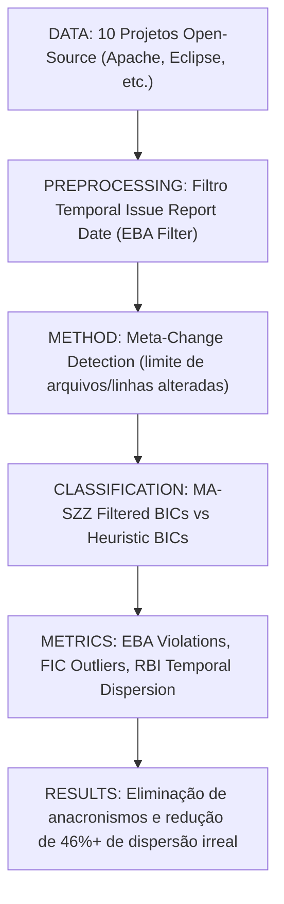

# Ficha Estruturada de Pesquisa Científica — ALGORITMO 03: MA-SZZ (Meta-Change Aware SZZ)

---

## 1. Identificação

* **Título**: A Framework for Evaluating the Results of the SZZ Approach for Identifying Bug-Introducing Changes
* **Autores**: Daniel Alencar da Costa, Shane McIntosh, Weiyi Shang, Uirá Kulesza, Roberta Coelho, Ahmed E. Hassan
* **Afiliações**: Queen's University (Canadá); Universidade Federal do Rio Grande do Norte - UFRN (Brasil); Concordia University (Canadá)
* **Ano**: 2017
* **Venue**: IEEE Transactions on Software Engineering (TSE), Vol. 43, N. 7, pp. 641–657, Julho 2017
* **DOI**: https://doi.org/10.1109/TSE.2016.2635134
* **URL (Paper)**: [03-maszz-tse2017.pdf](file:///home/artur-carvalho/mestrado/papers/03-maszz-tse2017.pdf) / [03-maszz-tse2017.txt](file:///home/artur-carvalho/mestrado/papers/03-maszz-tse2017.txt)
* **Identificação no Estudo**: **ALGORITMO 03 (MA-SZZ)**
* **Implementação Local**: [repos/03-maszz/](file:///home/artur-carvalho/mestrado/repos/03-maszz/) / [run_maszz.py](file:///home/artur-carvalho/mestrado/repos/03-maszz/run_maszz.py)

---

## 2. Problema

* **Problema Científico**:
  Variantes anteriores do SZZ (B-SZZ, AG-SZZ) introduziram heurísticas sem uma estrutura sistemática e empírica de avaliação. Pior: ao tentar melhorar o SZZ, pesquisadores inflaram inadvertidamente o número de commits incorretamente identificados. Além disso, mudanças que tocam dezenas de arquivos ou pacotes (*meta-changes* e commits de branch merge) acabam culpadas por centenas de bugs futuros não relacionados.
* **Critérios de Inconsistência Descobertos**:
  1. *Earliest Bug Appearance (EBA)*: Commits indutores identificados com data posterior à abertura do relatório do bug no tracker (anacronismo causal).
  2. *Future Impact of Changes (FIC)*: Um único commit comum sendo culpado por introduzir dezenas ou centenas de bugs no futuro (super-culpabilização estatística irreal).
  3. *Realism of Bug Introduction (RBI)*: Commits indutores separados por anos de distância entre as linhas que supostamente introduziram o mesmo defeito.

---

## 3. Perguntas de Pesquisa (Research Questions)

* **RQ1**: Em que medida as implementações existentes de SZZ identificam commits indutores que violam a consistência temporal (EBA)?
* **RQ2**: Existem commits que são apontados desproporcionalmente como indutores de múltiplos bugs distintos ao longo do tempo (FIC)?
* **RQ3**: Qual é a plausibilidade temporal e semântica de commits apontados como causadores das partes do mesmo bug (RBI)?
* **RQ4**: A filtragem consciente de meta-mudanças e commits de branch merge (*MA-SZZ*) melhora a consistência dos resultados?

---

## 4. Hipóteses

* **Hipótese 1 [FATO DOCUMENTADO - Seção 3]**: Um commit não pode ter introduzido um bug se sua data de submissão for posterior à data em que o bug foi relatado no sistema de controle de chamados ($T_{commit} > T_{issue\_report}$).
* **Hipótese 2 [FATO DOCUMENTADO - Seção 4]**: Commits gigantescos que alteram dezenas de arquivos com alterações de build, infraestrutura ou documentação (*meta-changes*) são capturados falsamente pelo SZZ devido à sua alta conectividade no grafo de blame.

---

## 5. Objetivos

* **Objetivo Geral**:
  Construir o primeiro framework formal de avaliação e consistência empírica para SZZ e propor a variante **MA-SZZ** (*Meta-Change Aware SZZ*) para eliminar meta-mudanças e anacronismos temporais.
* **Objetivos Específicos**:
  1. Formalizar as três métricas de plausibilidade: *Earliest Bug Appearance (EBA)*, *Future Impact of Changes (FIC)* e *Realism of Bug Introduction (RBI)*.
  2. Avaliar 5 implementações representativas de SZZ em 10 projetos open-source de grande porte.
  3. Implementar a estratégia de filtragem de *meta-changes* e branch merges no MA-SZZ.
  4. Fornecer diretrizes para a construção de datasets de predição Just-in-Time livres de contaminação anacrônica.

---

## 6. Metodologia

* **Passo 1: Verificação Temporal (EBA)**: Para cada bug fix $C_{fix}$, recupera-se a data da issue $T_{report}$. Descarta-se sumariamente qualquer candidato $C_{bic}$ onde $\text{Timestamp}(C_{bic}) \ge T_{report}$.
* **Passo 2: Detecção de Meta-Changes**: Commits que tocam número anômalo de arquivos (ex.: reestruturações globais de pacotes, atualizações de licença ou scripts de deploy) são classificados como meta-mudanças e ignorados pelo blame.
* **Passo 3: Auditoria de Branch Merges**: Merges de branches que apenas unem históricos sem introduzir linhas lógicas novas não são marcados como BICs.

---

## 7. Datasets / Dados Utilizados

* 10 sistemas open source de grande escala: **Apache Commons (bcel, beanutils, codec, collections, compress, csv, io, lang, math, net)**, **Eclipse Bugzilla**, e projetos Java consolidados.
* Dezenas de milhares de issues resolvidas e centenas de milhares de linhas analisadas.

---

## 8. Principais Resultados e Descobertas

1. **Inconsistência Massiva Prévia**: Variantes heurísticas anteriores rotulavam até 46% dos bugs como causados por commits separados por anos de diferença, violando o princípio de coesão do defeito.
2. **Super-Culpabilização (FIC)**: Commits únicos de merge e meta-mudanças eram acusados de introduzir mais de 100 defeitos subsequentes independentes.
3. **Eficácia do MA-SZZ**: A introdução de janelas de corte temporal e descarte de meta-changes restaurou a consistência lógica sem degradar a capacidade de localização.

---

## 9. Ameaças à Validade

* **Validade Interna**: Dependência da acurácia e integridade das datas registradas no Bug Tracker (problemas de data desregulada ou reabertura de tickets).
* **Validade de Construção**: Definição de limites estáticos para caracterizar uma meta-change pode desconsiderar commits legítimos de refatoração ampla.

---

## 10. Métricas e Fórmulas

* **Critério EBA**:
  $$\text{IsEBAValid}(C_{bic}, I_{bug}) \iff \text{Date}(C_{bic}) < \text{ReportDate}(I_{bug})$$
* **Critério de Impacto Futuro (FIC)**:
  $$\text{FIC}(C) = |\{ I_{bug} \mid C \in \text{BICs}(I_{bug}) \}|$$
* **Filtro MA-SZZ**:
  $$\text{BICs}_{MA}(I) = \{ C \in \text{BICs}_{AG}(I) \mid \text{IsEBAValid}(C, I) \land \neg \text{IsMetaChange}(C) \}$$

---

## 11. Aplicação Prática no Benchmark Flink

* Execução do script `repos/03-maszz/run_maszz.py` consumindo `repos/00-flink/extracted_fixes/flink_bugfix_commits.json`.
* Valida a remoção de commits gigantes de merge e migrações de módulo no Apache Flink, comparando o volume de BICs gerados versus AG-SZZ.

---

## 12. Referências Bibliográficas

* Daniel Alencar da Costa, Shane McIntosh, Weiyi Shang, Uirá Kulesza, Roberta Coelho, Ahmed E. Hassan. "A Framework for Evaluating the Results of the SZZ Approach for Identifying Bug-Introducing Changes". In *IEEE Transactions on Software Engineering*, 43(7):641–657, 2017. DOI: [10.1109/TSE.2016.2635134](https://doi.org/10.1109/TSE.2016.2635134).
