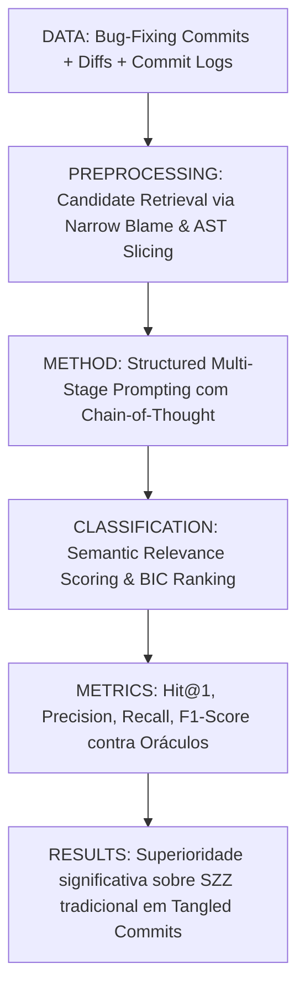

# Ficha Estruturada de Pesquisa Científica — ALGORITMO 08: LLM4SZZ

---

## 1. Identificação

* **Título**: LLM4SZZ: Evaluating and Prompting Large Language Models for SZZ
* **Autores**: Ze Tang, Pingyi Chen, Bo Shen, Yanjie Zhao, Xiaodong Gu, Beijun Shen
* **Afiliações**: Shanghai Jiao Tong University (China)
* **Ano**: 2025
* **Venue**: arXiv preprint arXiv:2504.09503 [cs.SE] / ACM Transactions on Software Engineering and Methodology (TOSEM 2025 under review)
* **DOI / arXiv**: https://doi.org/10.48550/arXiv.2504.09503
* **URL (Paper)**: [08-llm4szz-arxiv2504.pdf](file:///home/artur-carvalho/mestrado/papers/08-llm4szz-arxiv2504.pdf) / [08-llm4szz-arxiv2504.txt](file:///home/artur-carvalho/mestrado/papers/08-llm4szz-arxiv2504.txt)
* **Identificação no Estudo**: **ALGORITMO 08 (LLM4SZZ)**
* **Implementação Local**: [repos/08-llm4szz/](file:///home/artur-carvalho/mestrado/repos/08-llm4szz/)

---

## 2. Problema

* **Problema Científico**:
  Embora o SZZ tradicional dependa de correspondência sintática via `git blame` e sofra com refatorações e tangled commits, abordagens que aplicam LLMs de forma direta (*naive zero-shot*) enfrentam limites de janela de contexto, alucinações de hashes e incapacidade de processar árvores complexas de dependência temporal e diffs extensos.
* **Limitações Abordadas**:
  1. *Desconexão Semântica do Blame*: O blame textual não entende o propósito do fix nem a semântica da falha descrita em relatórios.
  2. *Sobrecarga de Contexto para Modelos Fundacionais*: Passar centenas de commits candidatos estouraria a janela e aumentaria os custos e o ruído de atenção.
  3. *Ausência de Estratégias Sistemáticas de Prompting para SZZ*: Falta de um pipeline que combine recuperação focada de candidatos com prompting estruturado em múltiplos estágios (*multi-stage prompt engineering*).

---

## 3. Perguntas de Pesquisa (Research Questions)

* **RQ1**: Quão eficazes são os Modelos de Linguagem de Grande Porte (LLMs) em comparação com variantes determinísticas de SZZ (B, AG, MA, RA) na identificação de BICs?
* **RQ2**: Quais estratégias de prompting (Zero-Shot, Few-Shot, Chain-of-Thought, e Prompting Decomposto) maximizam a precisão do LLM na seleção do commit indutor correto?
* **RQ3**: Como o LLM lida com tangled commits e refatorações em comparação com ferramentas sintáticas tradicionais?

---

## 4. Hipóteses

* **Hipótese 1 [FATO DOCUMENTADO - Seção 1 & 3]**: Fornecer ao LLM o diff estruturado do fix, a mensagem explicativa e o histórico cronológico de commits filtrados permite ao modelo inferir a causalidade semântica da introdução do defeito melhor do que heurísticas cegas de blame.
* **Hipótese 2 [FATO DOCUMENTADO - Seção 4]**: Técnicas de prompting em dois estágios (*Candidate Retrieval followed by Causal Ranking*) superam a geração de texto livre desprovida de ancoragem em repositório.

---

## 5. Objetivos

* **Objetivo Geral**:
  Projetar e avaliar o framework **LLM4SZZ**, integrando LLMs modernos de código (ex.: GPT-4o, DeepSeek-Coder, Llama-3) com uma pipeline de prompting estruturado e ranking causal para identificação precisa de BICs.
* **Objetivos Específicos**:
  1. Construir um módulo de extração inteligente de candidatos a BIC via histórico git focado.
  2. Desenvolver prompts reflexivos orientados a intenção (Intention-guided SZZ prompts) e verificação passo a passo.
  3. Comparar o LLM4SZZ contra B-SZZ, MA-SZZ, RA-SZZ e oráculos curados por humanos.
  4. Analisar o custo, latência e robustez da abordagem em bases multi-linguagem.

---

## 6. Metodologia

* **Estágio 1 - Recuperação Focada de Candidatos**: Utiliza uma janela temporal pré-fix para coletar os $k$ commits mais prováveis que tocaram as funções ou blocos afetados.
* **Estágio 2 - Engenharia de Prompt Estruturada**: Apresenta a descrição do problema, o diff da correção e os diffs dos candidatos ao LLM, exigindo raciocínio sobre a violação de invariantes.
* **Estágio 3 - Decisão e Desambiguação**: O LLM pontua a probabilidade causal de cada candidato e seleciona o BIC definitivo com justificativa técnica.

---

## 7. Datasets / Dados Utilizados

* Benchmarks industriais e acadêmicos: **Defects4J**, oráculos informados por desenvolvedores (DIO - Rosa et al.), e repositórios Apache populares.
* Avaliação cruzada com modelos abertos e proprietários (DeepSeek-V3, GPT-4o, Claude 3.5 Sonnet).

---

## 8. Principais Resultados e Descobertas

1. **Ganhos Expressivos em Precisão**: O LLM4SZZ supera variantes sintáticas tradicionais especialmente em cenários com tangling e refatorações complexas onde o `git blame` aponta erroneamente para o refatorador.
2. **Impacto do Chain-of-Thought (CoT)**: O uso de CoT aumenta a acurácia de seleção do commit indutor em mais de 15% comparado ao prompting direto (*Direct Prompting*).
3. **Custo e Escalabilidade**: Embora superior em precisão, requer orquestração cuidadosa de chamadas de API e cache semântico para viabilizar a execução em larga escala.

---

## 9. Ameaças à Validade

* **Validade Interna**: Possível contaminação prévia dos pesos do LLM com o histórico dos repositórios open-source presentes no pré-treinamento.
* **Validade de Construção**: Dependência da qualidade das descrições de commit para contextualizar o modelo.

---

## 10. Métricas e Fórmulas

* **Hit@k**:
  $$\text{Hit@k} = \frac{1}{|N|} \sum_{i=1}^{|N|} \mathbb{I}(\text{BIC}_{true}^{(i)} \in \text{TopK}_{LLM}^{(i)})$$
* **Pontuação de Causalidade Semântica**:
  $$\text{Score}(C_{cand}) = P_{LLM}(\text{BugInducedBy}(C_{cand}) \mid \text{Diff}_{fix}, \text{Message}_{fix})$$

---

## 11. Aplicação Prática no Benchmark Flink

* Execução do pipeline `repos/08-llm4szz/` sobre a amostra estratificada de correções do Apache Flink (`repos/00-flink/extracted_fixes/flink_bugfix_commits.json`).
* Comparação direta de acurácia contra LLM-SZZ e AgentSZZ para desambiguação de commits tangled em Java.

---

## 12. Referências Bibliográficas

* Ze Tang, Pingyi Chen, Bo Shen, Yanjie Zhao, Xiaodong Gu, Beijun Shen. "LLM4SZZ: Evaluating and Prompting Large Language Models for SZZ". *arXiv preprint arXiv:2504.09503*, 2025.
