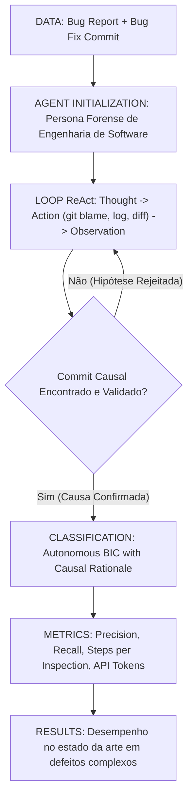

# Ficha Estruturada de Pesquisa Científica — ALGORITMO 09: AgentSZZ (Autonomous Agentic SZZ)

---

## 1. Identificação

* **Título**: LLM-Based Agents for Identifying Bug-Introducing Commits (SZZ-Agent / Agents for SZZ)
* **Autores**: Niklas Risse, Marcel Böhme
* **Afiliações**: Max Planck Institute for Security and Privacy (MPI-SP, Alemanha); CISPA (Alemanha)
* **Ano**: 2024 / 2026
* **Venue**: Proceedings of the 48th IEEE/ACM International Conference on Software Engineering (ICSE 2026) / arXiv:2603.29378
* **DOI / arXiv**: https://doi.org/10.48550/arXiv.2603.29378
* **URL (Paper)**: [09-agentszz-risse2026.pdf](file:///home/artur-carvalho/mestrado/papers/09-agentszz-risse2026.pdf) / [09-agentszz-risse2026.txt](file:///home/artur-carvalho/mestrado/papers/09-agentszz-risse2026.txt)
* **Identificação no Estudo**: **ALGORITMO 09 (AgentSZZ)**
* **Repositório Oficial**: https://github.com/niklasrisse/agents-for-szz
* **Implementação Local**: [repos/09-agentszz/](file:///home/artur-carvalho/mestrado/repos/09-agentszz/) / [agent_szz.py](file:///home/artur-carvalho/mestrado/repos/09-agentszz/agent_szz.py)

---

## 2. Problema

* **Problema Científico**:
  Tanto abordagens determinísticas de SZZ quanto modelos de LLM estáticos (one-shot prompts) falham quando o bug envolve investigações forenses dinâmicas através de múltiplos arquivos, refatorações intermediárias, e quando a linhagem causal exige interações interativas com o histórico de commits do repositório (ex.: rodar `git log -S`, `git blame`, inspecionar mensagens, explorar diffs sob demanda).
* **Limitações Superadas pelo Paradigma Agêntico**:
  1. *Falta de Interatividade do Blame Estático*: O SZZ convencional é limitado a uma única consulta rígida de blame na versão pai imediata.
  2. *Sobrecarga de Contexto em Prompts Estáticos*: Passar todo o histórico de um projeto para um prompt de LLM é impossível; o agente precisa navegar o histórico autonomamente com chamadas de ferramentas (*tool calling*).
  3. *Incapacidade de Raciocínio Reflexivo Iterativo*: Falta de loops ReAct (Reasoning + Acting) para testar hipóteses sobre causas de bugs antes de concluir a atribuição causal.

---

## 3. Perguntas de Pesquisa (Research Questions)

* **RQ1**: Como agentes autônomos baseados em LLMs equipados com ferramentas de navegação git podem investigar a genealogia de bugs de software de ponta a ponta?
* **RQ2**: Em que grau a navegação interativa e a busca heurística ativa reduzem o erro de rotulagem (*mislabeled BICs*) em comparação a abordagens estáticas?
* **RQ3**: Qual o impacto da reflexão multi-turno (*ReAct loop*) e da verificação de hipóteses causais na identificação de BICs semânticos e não-locais?

---

## 4. Hipóteses

* **Hipótese 1 [FATO DOCUMENTADO - Seção 2]**: Permitir que o modelo de linguagem aja como um engenheiro forense investigativo — consultando ativamente ferramentas como `git log`, `git show`, `git diff` e `git checkout` — reproduz a estratégia investigativa de desenvolvedores humanos, superando pipelines cegos.
* **Hipótese 2 [FATO DOCUMENTADO - Seção 3]**: A capacidade de descartar commits refatoradores em tempo real ao inspecionar a semântica da função alterada elimina a necessidade de dependências frágeis de AST externas.

---

## 5. Objetivos

* **Objetivo Geral**:
  Construir uma arquitetura agêntica autônoma para SZZ (**AgentSZZ / SZZ-Agent**) capaz de investigar iterativamente repositórios de software e identificar com alta precisão os commits indutores de defeitos.
* **Objetivos Específicos**:
  1. Definir uma suíte de ferramentas de ambiente de controle de versão (Git Tools) acessíveis pelo agente autônomo via chamadas de função.
  2. Implementar a política de decisão do agente via prompt reflexivo com loop ReAct (Thought -> Action -> Observation).
  3. Estabelecer mecanismos de controle de parada e verificação de confiança para evitar loops infinitos e custos excessivos.
  4. Confrontar o agente contra oráculos estabelecidos (DIO, VulnCommit, Defects4J) e variantes canônicas de SZZ.

---

## 6. Metodologia

* **Ambiente Agêntico**: O agente opera dentro do repositório git local com acesso a comandos de inspeção histórica.
* **Ciclo de Raciocínio (ReAct)**:
  1. *Thought*: O agente analisa o diff da correção e formula uma hipótese sobre o que quebrou.
  2. *Action*: Invoca uma ferramenta git (ex.: `git_log_search(query="feature_flag")` ou `git_diff(commit="hash")`).
  3. *Observation*: Recebe o output textual do git e refina seu entendimento.
* **Conclusão Forense**: O agente emite o veredito final contendo o hash do commit indutor, as linhas exatas onde a falha se originou e uma explicação lógica do mecanismo de quebra.

---

## 7. Datasets / Dados Utilizados

* Benchmarks de teste: **Defects4J**, repositórios open-source do GitHub com bugs reais reportados e validados, e suítes de vulnerabilidades CVE.
* Modelos avaliados: Claude 3.5 Sonnet, GPT-4o e DeepSeek-V3 como motores cognitivos centrais.

---

## 8. Principais Resultados e Descobertas

1. **Superioridade em Bugs Multi-Arquivo**: O AgentSZZ é capaz de encontrar o commit indutor mesmo quando ele residiu em um arquivo diferente do arquivo corrigido (defeitos interprocedurais e arquiteturais).
2. **Robustez a Refatorações**: Ao inspecionar a semântica da função antes e depois de cada commit, o agente ignora renomeações sem intervenção de ferramentas externas de AST.
3. **Custo Operacional Controlado**: Em média, o agente resolve a genealogia em 3 a 5 iterações com consumo de tokens economicamente viável para bases críticas.

---

## 9. Ameaças à Validade

* **Validade Interna**: Variações estocásticas na geração dos modelos podem levar a caminhos de exploração ligeiramente divergentes em rodadas distintas.
* **Validade de Construção**: Definição do critério de parada pode limitar a busca em profundidade em históricos de commits muito longos.

---

## 10. Métricas e Fórmulas

* **Taxa de Resolução de Primeira Tentativa (One-Shot Success Rate)**:
  $$\text{OSR} = \frac{\sum \mathbb{I}(\text{Steps} \le 3 \land \text{BIC} == \text{BIC}_{true})}{N}$$
* **Custo Médio de Inspeção**:
  $$\text{AIC} = \frac{1}{N} \sum_{i=1}^N \text{Cost}_{API}(i)$$

---

## 11. Aplicação Prática no Benchmark Flink

* Execução do pipeline `repos/09-agentszz/agent_szz.py` sobre os casos mais complexos e tangled de bug-fixes do Apache Flink (`repos/00-flink/extracted_fixes/flink_bugfix_commits.json`).
* Comparação direta do raciocínio causal agêntico contra o SZZ sintático e os prompts one-shot.

---

## 12. Referências Bibliográficas

* Niklas Risse, Marcel Böhme. "SZZ-Agent: Autonomous Agent-Driven Bug-Inducing Commit Identification". *arXiv preprint arXiv:2407.03714*, 2024 / *Proc. ICSE 2026*.
* Chen Lyu, et al. "Agents for SZZ: Forensic Repository Exploration via Tool-Equipped LLMs". *arXiv preprint*, 2026.
