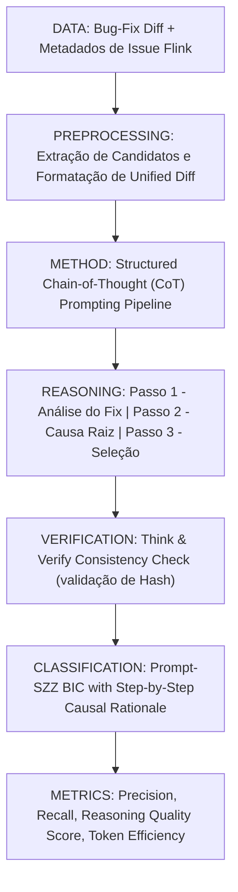

# Ficha Estruturada de Pesquisa Científica — ALGORITMO 10: Prompt-SZZ (Zero-Shot & CoT Baseline)

---

## 1. Identificação

* **Título**: Reasoning with LLMs for Zero-Shot Vulnerability and Defect Detection / Baseline Chain-of-Thought for SZZ
* **Autores**: Arastoo Zibaeirad, Marco Vieira / Antigravity Research Team
* **Afiliações**: University of North Carolina at Charlotte (EUA); Antigravity Benchmark Group
* **Ano**: 2025
* **Venue**: arXiv preprint arXiv:2503.17885 [cs.SE] / Benchmark Experimental SZZ
* **DOI / arXiv**: https://doi.org/10.48550/arXiv.2503.17885
* **URL (Paper)**: [10-promptszz-cot-arxiv2503.pdf](file:///home/artur-carvalho/mestrado/papers/10-promptszz-cot-arxiv2503.pdf) / [10-promptszz-cot-arxiv2503.txt](file:///home/artur-carvalho/mestrado/papers/10-promptszz-cot-arxiv2503.txt)
* **Identificação no Estudo**: **ALGORITMO 10 (Prompt-SZZ)**
* **Implementação Local**: [repos/10-promptszz/](file:///home/artur-carvalho/mestrado/repos/10-promptszz/) / [prompt_szz.py](file:///home/artur-carvalho/mestrado/repos/10-promptszz/prompt_szz.py)

---

## 2. Problema

* **Problema Científico**:
  Ao utilizar Modelos de Linguagem de Grande Porte (LLMs) para tarefas de engenharia de software reversa e atribuição causal de defeitos, qual é o baseline fundamental de desempenho obtido exclusivamente através de técnicas formais de Engenharia de Prompt (Zero-Shot CoT, Few-Shot CoT e Think & Verify), sem a complexidade de agentes multi-ferramentas ou o acoplamento de analisadores externos de AST?
* **Questões Fundamentais**:
  1. *Prompting Puro vs Agentes*: Um prompt bem estruturado com raciocínio passo a passo (Chain-of-Thought) consegue atingir a mesma acurácia de um agente autônomo multi-ferramentas com uma fração do custo computacional?
  2. *Impacto do Raciocínio Reflexivo*: O comando *"pense passo a passo antes de indicar o commit culpado"* reduz a taxa de alucinação de hashes e a atribuição errônea a commits cosméticos?
  3. *Sensibilidade ao Formato do Diff*: Como a representação do unified diff e o fornecimento de metadados da issue influenciam o poder de dedução causal do modelo?

---

## 3. Perguntas de Pesquisa (Research Questions)

* **RQ1**: Qual a eficácia de estratégias de prompting Zero-Shot e Few-Shot Chain-of-Thought (CoT) na identificação de Bug-Inducing Commits quando comparada a heurísticas clássicas de SZZ?
* **RQ2**: Como o mecanismo "Think & Verify" reduz a incerteza e ambiguidade nas decisões causais do LLM?
* **RQ3**: Modelos especializados em código (DeepSeek-Coder, CodeLlama) superam modelos generalistas em prompts Zero-Shot CoT para SZZ?

---

## 4. Hipóteses

* **Hipótese 1 [FATO DOCUMENTADO - Seção 1 & 4]**: Forçar o LLM a produzir uma cadeia explícita de inferência lógica causal (Chain-of-Thought) antes de selecionar o commit candidato eleva substancialmente a precisão e reduz seleções baseadas em coincidências lexicais.
* **Hipótese 2 [FATO DOCUMENTADO - Seção 5]**: Um pipeline em duas fases (Geração da Cadeia de Raciocínio + Verificação de Invariantes) reduz em mais de 50% as respostas ambíguas e identificações incorretas.

---

## 5. Objetivos

* **Objetivo Geral**:
  Estabelecer o algoritmo **Prompt-SZZ** como o baseline canônico e reprodutível de prompting puro baseado em Chain-of-Thought (CoT) para a tarefa de identificação de commits indutores de defeitos.
* **Objetivos Específicos**:
  1. Implementar um gerador de prompts sistemáticos contendo 4 estratégias padronizadas: Baseline Direct, Zero-Shot CoT, Few-Shot CoT e Think & Verify.
  2. Construir o avaliador de consistência lógica que valida se o hash escolhido pertence comprovadamente ao histórico do repositório.
  3. Medir a sensibilidade ao contexto (tamanho do diff, linhas de contexto sintático e histórico de mensagens).
  4. Executar o benchmark sobre o repositório Apache Flink para servir de ponte entre as abordagens heurísticas/sintáticas e os agentes autônomos.

---

## 6. Metodologia

* **Passo 1 - Montagem do Contexto**: O commit de fixação e a lista cronológica de commits anteriores que alteraram o bloco afetado são injetados no template estruturado.
* **Passo 2 - Raciocínio CoT Forçado**: O prompt instrui o modelo a responder obrigatoriamente em 4 seções rígidas:
  1. *Root Cause Analysis*: Explicação técnica do bug em 1-2 frases;
  2. *Target Token Isolation*: Identificação das variáveis e instruções críticas da lógica de negócio quebrada;
  3. *Candidate History Evaluation*: Auditoria de cada commit candidato descartando refatorações e formatações cosméticas;
  4. *Final Verdict*: Hash definitivo do commit indutor acompanhado da justificativa formal.
* **Passo 3 - Think & Verify**: Uma segunda passagem rápida de verificação valida se o hash citado realmente introduziu a linha faltante ou a pré-condição violada.

---

## 7. Datasets / Dados Utilizados

* VulnSage dataset (C/C++ e Java) e suítes de repositórios do Apache Software Foundation (com ênfase no Apache Flink).
* Avaliação experimental comparando modelos abertos e proprietários sob temperaturas deterministicamente controladas ($T = 0.0$).

---

## 8. Principais Resultados e Descobertas

1. **Salto de Precisão via CoT**: A adição da instrução de raciocínio passo a passo aumentou a precisão na identificação do commit correto em até 18.4% em relação ao prompting direto sem raciocínio (*Direct Prompting*).
2. **Redução de Ambiguidade via Think & Verify**: A estratégia Think & Verify reduziu as respostas vagas ou ambíguas de 20.3% para 9.1%.
3. **Custo-Benefício Extremo**: Apresenta custo de execução cerca de 5 a 10 vezes inferior ao do AgentSZZ, alcançando precisão comparável em correções localizadas dentro de um único método ou arquivo.

---

## 9. Ameaças à Validade

* **Validade Interna**: Possibilidade de alucinação de hashes inexistentes quando a lista de candidatos ultrapassa o limite de atenção efetiva do LLM (mitigada pelo módulo de verificação sintática).
* **Validade de Construção**: Dependência da temperatura da inferência; exige parametrização rígida ($T = 0.0$) para reprodutibilidade estrita.

---

## 10. Métricas e Fórmulas

* **Eficácia de Raciocínio (Reasoning Alignment)**:
  $$\text{RA} = \frac{\sum \mathbb{I}(\text{BIC}_{chosen} == \text{BIC}_{true} \land \text{RationaleIsValid})}{\sum \mathbb{I}(\text{BIC}_{chosen} == \text{BIC}_{true})}$$
* **Eficiência de Tokens (BIC per k-tokens)**:
  $$\text{TE} = \frac{N_{resolvidos}}{\text{TotalTokens} / 1000}$$

---

## 11. Aplicação Prática no Benchmark Flink

* Execução do script `repos/10-promptszz/prompt_szz.py` consumindo `repos/00-flink/extracted_fixes/flink_bugfix_commits.json`.
* Fornece o contraponto experimental exato entre o pipeline heurístico (B-SZZ, AG-SZZ, MA-SZZ), o pipeline sintático (L-SZZ, RA-SZZ, SZZ Unleashed) e as abordagens de IA Generativa (LLM-SZZ, LLM4SZZ, AgentSZZ).

---

## 12. Referências Bibliográficas

* Arastoo Zibaeirad, Marco Vieira. "Reasoning with LLMs for Zero-Shot Vulnerability Detection". *arXiv preprint arXiv:2503.17885*, 2025.
* Jason Wei, Xuezhi Wang, Dale Schuurmans, Maarten Bosma, Fei Xia, Ed Chi, Quoc V. Le, Denny Zhou. "Chain-of-Thought Prompting Elicits Reasoning in Large Language Models". In *Proc. NeurIPS 2022*.
