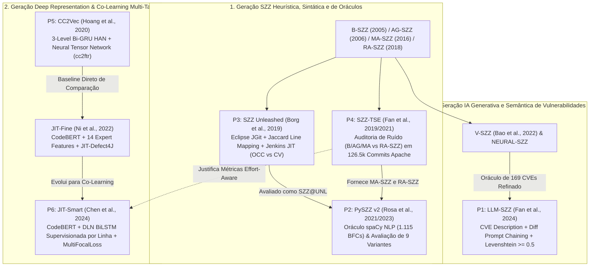

# Matriz Comparativa das 6 Pesquisas de SZZ e Predição/Localização JIT de Defeitos

---

## 1. Visão Geral e Alinhamento Estratégico

Este documento consolida a análise comparativa transversal e de alta densidade técnica dos 6 estudos empíricos selecionados para fundamentar o **Artigo Científico (Banca Preparatória de Dezembro de 2026)**, a **Entrega de Qualificação/TCC (Dezembro de 2027)** e a **Dissertação de Mestrado**.

O corpus de pesquisa abrange a evolução paradigmática da Engenharia de Software Empírica (ESE) na identificação de alterações indutoras de defeitos/vulnerabilidades (*Bug/Vulnerability-Inducing Commits - BIC/VIC via SZZ*) e na predição/localização de defeitos em tempo de commit (*Just-In-Time Defect Prediction and Localization - JIT-DP / JIT-DL*):

1. **P1: LLM-SZZ** (*Siqi Fan et al., 2024*) — Identificação de *Vulnerability-Inducing Commits* (VIC) orientada por LLMs (`GPT-3.5-Turbo`, `DeepSeek-V2.5`), descrições de CVE (NVD), *Prompt Chaining*, decisão autônoma de retrocesso com filtro de similaridade de Levenshtein ($\ge 0.5$), *Optimal Candidate Selection* e *Voting Strategy* (3–5 rodadas).
2. **P2: PySZZ v2** (*Giovanni Rosa et al., ICSE 2021 / JSS 2023*) — Construção de oráculo informado por desenvolvedores (1.115 BFCs extraídos de 19,6M commits do GH Archive via árvores sintáticas `spaCy` H1–H3 e validação manual quádrupla) e benchmark de 9 abordagens SZZ (`B-SZZ`, `AG-SZZ`, `MA-SZZ`, `L-SZZ`, `R-SZZ`, `RA-SZZ*`, `SZZ@PYD`, `SZZ@UNL`, `SZZ@OPN`).
3. **P3: SZZ Unleashed** (*Markus Borg et al., 2019*) — Implementação aberta agnóstica de linguagem baseada em `Eclipse JGit` e *Line Number Mapping* de Williams & Spacco via distância de Jaccard (`depth = 3`), acoplada a estudo de predição JIT no **Jenkins Core** (26.378 commits, 16 features incluindo acoplamento evolutivo via `code-maat`), comparando *Stratified 10-Fold CV* vs. *Online Change Classification (OCC)* com `SMOTE+Tomek`.
4. **P4: SZZ-TSE** (*Yuanrui Fan et al., IEEE TSE 2019/2021*) — Auditoria empírica em larga escala (126.526 commits em 10 projetos Apache) do impacto de alterações mal-rotuladas (*mislabeled changes*) por `B-SZZ`, `AG-SZZ` e `MA-SZZ` (frente ao baseline `RA-SZZ`) sobre o desempenho preditivo, importância de features (*Scott-Knott ESD*) e esforço desperdiçado de inspeção (*Wasted Effort LOC*) via 1.000 iterações de *Out-of-Bag Bootstrap*.
5. **P5: CC2Vec** (*Thong Hoang et al., ACM/IEEE ICSE 2020*) — Aprendizado profundo de representações distribuídas de patches (`cc2ftr`) via Rede de Atenção Hierárquica em 3 níveis (`WordRNN`, `SentRNN`, `HunkRNN` Bi-GRU) e 5 famílias de comparação vetorial (*Neural Tensor Network* $e_{NT}$, $e_{NN}$, $e_{sim}$, $e_{sub}$, $e_{mul}$), supervisionado pela primeira linha da mensagem de commit.
6. **P6: JIT-Smart / JIT-Defect4J** (*Xiangping Chen et al., ACM FSE 2024; Chao Ni et al., ESEC/FSE 2022*) — Co-aprendizado multi-tarefa unificando `CodeBERT` + projeção $\tanh$ de 14 *expert features* (nível de commit) e *Defect Localization Network* (`DLN` / `HAN_MODEL` BiLSTM hierárquica supervisionada em nível de linha) via perda adaptativa `MultiFocalLoss` ($0.3\mathcal{L}_{dp} + 0.7\mathcal{L}_{dl}$) sobre o benchmark **JIT-Defect4J** (21 projetos Java).

---

## 2. Matriz Comparativa Estrutural e Algorítmica

| Dimensão Analisada | P1: LLM-SZZ | P2: PySZZ v2 | P3: SZZ Unleashed | P4: SZZ-TSE | P5: CC2Vec | P6: JIT-Smart / JIT-Fine |
| :--- | :--- | :--- | :--- | :--- | :--- | :--- |
| **Autores Principais** | S. Fan, X. Liu, S. Li et al. | G. Rosa, L. Pascarella, G. Bavota et al. | M. Borg, O. Svensson et al. | Y. Fan, X. Xia, D. A. Costa, D. Lo, A. E. Hassan | T. Hoang, H. J. Kang, D. Lo, J. Lawall | X. Chen, F. Xu et al. (e C. Ni, D. Lo et al.) |
| **Ano / Veículo** | 2024 (Preprint / Submissão) | 2021 (ICSE) / 2023 (JSS) | 2019 (arXiv:1903.01742) | 2019 / 2021 (IEEE TSE) | 2020 (ACM/IEEE ICSE) | 2024 (ACM FSE) / 2022 (ESEC/FSE) |
| **Paradigma Central** | LLMs + CVE Context + Levenshtein Backtrace | Mineração NLP (`spaCy`) + SZZ Estático/AST | `Eclipse JGit` + Jaccard Line Mapping + RF JIT | Auditoria de Ruído SZZ em Classificadores JIT | Deep Representation Learning (3-Level Bi-GRU HAN) | Multi-Task Co-Learning (`CodeBERT` + `DLN` BiLSTM) |
| **Granularidade de Saída** | Linha Deletada Raiz $\to$ VIC (Commit) | Linha Deletada $\to$ BIC (Commit) | Linha/Bloco $\to$ BIC (Commit) $\to$ Predição JIT | Commit-level (Predição JIT e Wasted LOC) | Embedding de Patch ($\mathbb{R}^{3d+4}$) $\to$ Commit/Log | Bivariada: Commit-level (JIT-DP) & Line-level (JIT-DL) |
| **Mecanismo de Filtragem / Supervisão** | Levenshtein $\ge 0.5$ + Parada Autônoma LLM (`-1`) + Voting (3–5x) | `srcML` (comentários), `RefactoringMiner 2.0`, `issue_date_filter` | Regex Jira + Jaccard Distance (`depth=3`) + Data da Issue | VIF / Spearman (`collinearity.csv`) + Baseline `RA-SZZ` | Auto-supervisão pelas palavras da 1ª linha do Commit Log | Supervisão direta de commit e de linha via `MultiFocalLoss` |
| **Linguagens Avaliadas** | C/C++ e Java | C, Py, C++, JS, Java, PHP, Ruby, C# | Agnóstico no motor SZZ (Estudo JIT em Java/Jenkins) | Java (10 projetos Apache) | Agnóstico (C no Linux Kernel; C++/Python em Qt/OpenStack) | Java (21 projetos Apache / JIT-Defect4J) |
| **Volume de Dados / Oráculo** | 169 CVEs verificadas por 3 especialistas (100 C/C++, 69 Java) | 19,6M commits $\to$ `oracle_all` (1.115 BFCs) e `oracle_issues` (129) | Jenkins Core: 26.378 commits (2.979 BFCs; 949 BICs = 3.6%) | 126.526 commits em 10 projetos Apache (`data_csvs/`) | 2M commits (LMG); 82k patches (Linux); 37k commits (Qt/OpenStack) | 21 projetos Java (`JIT-Defect4J` sobre `LLTC4J`) |
| **Métricas de Avaliação** | Recall, Precision, F1, FPR, Stability Rate | Recall, Precision, F1, Jaccard Overlap, Exclusividade | Precision, Recall, F1 (10-Fold CV vs. Online OCC) | AUC, F1, G-Mean, Recall@20%, Wasted LOC, Scott-Knott ESD | BLEU-4, ROUGE; AUC, F1, Accuracy (`PatchNet` / `DeepJIT`) | Commit: AUC, F1, FAR, DistHeaven, R@20%E, E@20%R, $P_{opt}$; Linha: Top-k, IFA |
| **Custo de Execução Local** | API Gratuita Estudantil Gemini / CPU (< 500 MB RAM) | CPU Local Multi-thread (~ 2 GB RAM) | CPU Local Java/Gradle + Python (~ 2 GB RAM) | CPU Local R/Python (~ 3 GB RAM) | Inferência CPU (`-device -1`) (~ 4 GB RAM) | Inferência CPU (`--do_test`) (~ 4–6 GB RAM) |

---

## 3. Linhagem Metodológica e Cadeia de Dependências Científicas

---

## 4. Interseção de Ecossistemas e Tensões Empíricas Documentadas

### A. Ecossistemas e Repositórios Compartilhados
- **Ecossistema Apache Java**: Presente transversalmente em **P1** (Tomcat, Struts, Camel, ActiveMQ), **P2** (projetos Java do `oracle_all` / `oracle_Jall`), **P4** (10 projetos Apache: `activemq`, `camel`, `derby`, `geronimo`, `hbase`, `hcommon`, `mahout`, `openjpa`, `pig`, `tuscany`) e **P6** (21 projetos Apache Commons/Gora/Giraph/Parquet no `JIT-Defect4J`).
- **Jenkins Core**: Objeto central da **P3** (26.378 commits) e presente nas vulnerabilidades Java auditadas pela **P1**.
- **Linux Kernel**: Avaliado nas vulnerabilidades C/C++ da **P1** e nos 82.000 patches da Tarefa 2 da **P5** (`CC2Vec`).

### B. Principais Conflitos e Descobertas Cruzadas entre as 6 Pesquisas
1. **O Paradoxo do SZZ Unleashed (P3 vs. P2)**:
   - Em **P3**, Borg et al. propõem o mapeamento agnóstico de linhas via distância de Jaccard e `depth=3`. Em **P2**, Rosa et al. executam o `SZZ@UNL` contra o oráculo informado por desenvolvedores e descobrem que, embora atinja o **maior Recall (0.72)** entre todas as 9 ferramentas, sua **Precisão colapsa para 0.06–0.09** devido a *outliers* de falsos positivos gerados pela ausência de filtragem sintática de comentários/formatação (`srcML`).
2. **A Ilusão de Estabilidade do AUC vs. Desperdício de Esforço (P4 vs. P3 e P6)**:
   - Em **P4**, Fan et al. provam que o ruído de `B-SZZ` não reduz significativamente o AUC ou F1 global, mas **aumenta em 9% a 10% o esforço desperdiçado de inspeção (`waste_effort` LOC)** (e `AG-SZZ` reduz o AUC em 1%–5% enquanto aumenta o desperdício em até 15%). Isso corrobora a conclusão de **P3** (onde o F1 realista em *Online Change Classification* foi de apenas $0.137$) e fundamenta a arquitetura de **P6** (`JIT-Smart`), que introduz a `DLN` supervisionada por linha e `MultiFocalLoss` para derrubar os alarmes falsos iniciais (`IFA`) no nível de linha.
3. **Limitação Estrutural do `git blame` em Correções Aditivas e Vulnerabilidades Profundas (P2 vs. P1)**:
   - Em **P2**, a análise qualitativa dos **311 casos de falha unânime** demonstra que todas as variantes SZZ falham quando a correção adiciona apenas guardas (ex.: `if (x != null)`) ou quando há múltiplos saltos históricos. Em **P1**, o `LLM-SZZ` resolve o rastreamento de vulnerabilidades profundas combinando distância de Levenshtein ($\tau=0.5$) com a autoridade semântica do LLM para interromper o retrocesso, elevando o Recall em vulnerabilidades profundas de $0.675$ (`V-SZZ`) para **$0.900$ (+22.5%)** em C/C++ e reduzindo a taxa de falsos positivos pela metade ($0.350 \to 0.162$).
4. **Representações Semânticas Puras vs. Fusão Multimodal e Multi-Tarefa (P5 vs. P6)**:
   - Em **P5**, o `CC2Vec` supera o `DeepJIT` em +7% de AUC ao aprender vetores distribuídos `cc2ftr`. Contudo, quando avaliado no benchmark `JIT-Defect4J` em **P6**, o `CC2Vec` puro atinge $\text{AUC}=0.7906$ e $F_1=0.2445$, sendo largamente superado pelo `JIT-Fine` e pelo `JIT-Smart` ($\text{AUC} > 0.88, F_1 > 0.45$), comprovando que a combinação de Transformers pré-treinados (`CodeBERT`), 14 *expert features* e co-aprendizado supervisionado em nível de linha (`DLN`) é superior a representações distribuídas isoladas.
