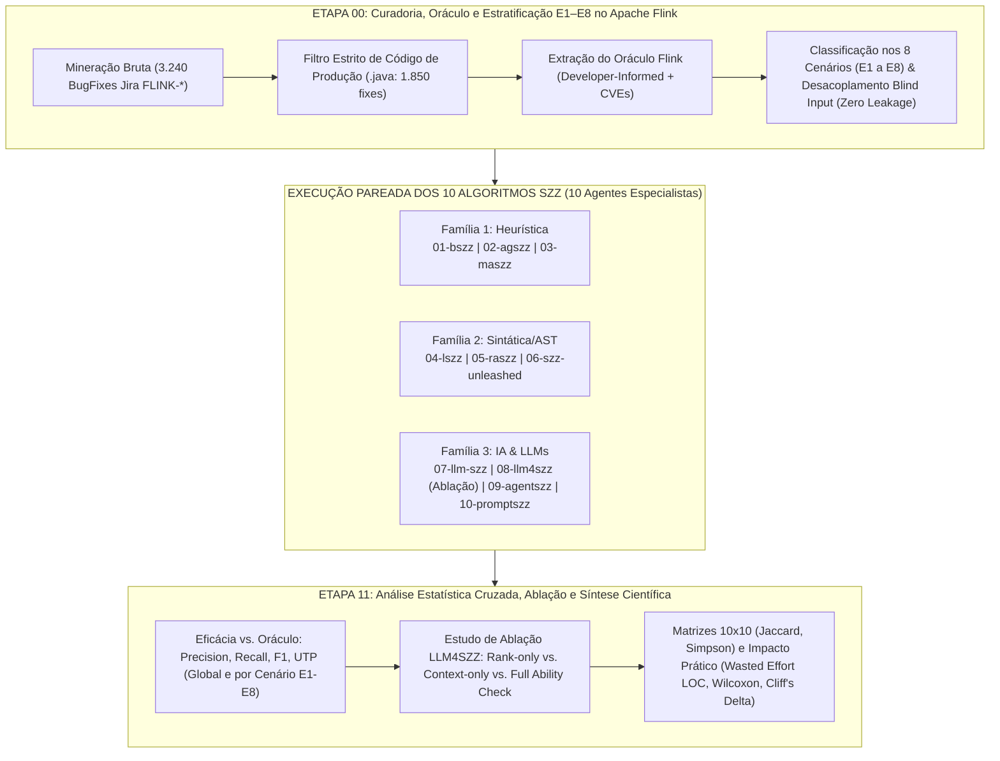

# Protocolo de Execução Experimental e Rastreabilidade Científica (10 Algoritmos SZZ no Apache Flink)

> [!IMPORTANT]
> **Registro de Governança (`DEC-007`, `DEC-008`, `DEC-009`, `DEC-010`, `DEC-011`, `DEC-012`, `DEC-013`)**: Este documento define o protocolo experimental canônico da pesquisa de Mestrado, alinhando simetricamente os **10 Algoritmos SZZ**, os **10 Agentes Especialistas (`expert-01-bszz` a `expert-10-promptszz`)**, o benchmark unificado **Apache Flink (`repos/00-flink`)** em seus **8 Cenários de Erro (`E1` a `E8`)** e o roadmap para as **20 Bases Empíricas (14 Java + 6 Python)**.

---

## 🎯 1. Visão Geral da Arquitetura Experimental e as 3 Research Questions

Para responder com rigor epistemológico (Wohlin et al.) à interseção entre SZZ e Just-In-Time Software Defect Prediction (JIT-SDP):
- **RQ1 (Eficácia por Cenário de Complexidade E1–E8 e Concordância Inter-Famílias)**: Qual é a Precisão, Recall, F1-Score e *Unique True Positives (UTP)* de cada um dos 10 algoritmos SZZ frente ao Oráculo Verificado do Apache Flink, e qual o grau de concordância pareada (*Jaccard*, *Szymkiewicz-Simpson*, *Kappa de Cohen*) entre as famílias Heurística (`01–03`), Sintática (`04–06`) e Baseada em LLMs (`07–10`)?
- **RQ2 (Anatomia Interna, Ablação do LLM4SZZ e Comparação de Modelos de IA)**: Qual é o ganho real proporcionado pelo mecanismo adaptativo *Ability Check* do LLM4SZZ ao alternar entre *Context-Enhanced* e *Rank-based*, e como as abordagens reflexivas (`LLM-SZZ`), seletivas (`LLM4SZZ`) e baseadas em agentes ReAct (`AgentSZZ`) se comparam em acurácia e latência?
- **RQ3 (Esforço Desperdiçado e Sinergia com Predição JIT por Commit — Song et al., FSE 2023)**: Quanto esforço de inspeção de código (*Wasted Effort LOC*) as abordagens sintáticas e de IA economizam ao mitigar falsos positivos, e como a sinergia com o paradigma prático de rotulagem humana (*HumLa* / *ECo-HumLa*) viabiliza o escalonamento para 20 bases bilingues (Java e Python)?

---

## 🏛️ 2. Simetria Canônica do Repositório (`00` a `10`)

| ID | Algoritmo SZZ | Família | Repositório Local | Ficha Técnica | Agente Especialista | Cenário de Destaque |
| :-: | :--- | :--- | :--- | :--- | :--- | :-: |
| **00** | **Apache Flink** | Base Unificada | `repos/00-flink/` | — | `skill-env-flink-benchmark` | **E1–E8** |
| **01** | **B-SZZ** | Heurística | `repos/01-bszz/` | `01-ficha-bszz.md` | `expert-01-bszz` | **E1** |
| **02** | **AG-SZZ** | Heurística | `repos/02-agszz/` | `02-ficha-agszz.md` | `expert-02-agszz` | **E2** |
| **03** | **MA-SZZ** | Heurística | `repos/03-maszz/` | `03-ficha-maszz.md` | `expert-03-maszz` | **E2 / E3** |
| **04** | **L-SZZ** | Sintática (`srcML`) | `repos/04-lszz/` | `04-ficha-lszz.md` | `expert-04-lszz` | **E2 / E4** |
| **05** | **RA-SZZ** | Sintática (`RefMiner`) | `repos/05-raszz/` | `05-ficha-raszz.md` | `expert-05-raszz` | **E3** |
| **06** | **SZZ Unleashed** | Sintática (`JGit`) | `repos/06-szz-unleashed/` | `06-ficha-szz-unleashed.md` | `expert-06-szz-unleashed` | **E3** |
| **07** | **LLM-SZZ** | LLM Chaining | `repos/07-llm-szz/` | `07-ficha-llm-szz.md` | `expert-07-llm-szz` | **E5 / E6** |
| **08** | **LLM4SZZ** | LLM Ability Check | `repos/08-llm4szz/` | `08-ficha-llm4szz.md` | `expert-08-llm4szz` | **E4 / E8** |
| **09** | **AgentSZZ** | LLM ReAct Agent | `repos/09-agentszz/` | `09-ficha-agentszz.md` | `expert-09-agentszz` | **E7 / E8** |
| **10** | **Prompt-SZZ** | LLM Zero-Shot CoT | `repos/10-promptszz/` | `10-ficha-promptszz.md` | `expert-10-promptszz` | **E1 / E2** |

---

## 🔬 3. Taxonomia dos 8 Cenários de Avaliação no Apache Flink (`E1` a `E8`)

1. **Estrato E1 — Bugs Atômicos & Diretos (*Single-Hunk Logic Modification*)**:
   - Correções cirúrgicas em 1 arquivo `.java` de produção ($\le 5$ linhas deletadas) sem ruído cosmético ou refatoração.
2. **Estrato E2 — Ruído Cosmético, Javadoc & Anotações (*Cosmetic & Metadata Noise*)**:
   - Commits que misturam correção de lógica com comentários, cabeçalhos de licença, formatação ou anotações (`@Override`, `@Nullable`).
3. **Estrato E3 — Refatorações Estruturais & Evolução Multi-Salto (*Structural Refactoring & Line Movement*)**:
   - Correções cujo trecho sofreu *Extract Method*, *Rename*, *Move* ou reorganização interna em commits intermediários.
4. **Estrato E4 — *Tangled Commits* (*Multi-Purpose / Large Patches*)**:
   - Patches extensos que modificam múltiplos arquivos/métodos ($\ge 3$ classes ou $> 25$ linhas deletadas) com múltiplos objetivos simultâneos.
5. **Estrato E5 — Correções por Adição Pura (*Add-Only Fixes*) & Bugs Multi-Arquivo**:
   - Correções defensivas com $0$ linhas de código Java deletadas (`deleted_lines == 0`, inserção de checagens `if (x == null)`) ou causa raiz externa.
6. **Estrato E6 — Vulnerabilidades de Segurança / CVEs (*Security Advisories*)**:
   - Defeitos catalogados como CVEs com impacto no NVD (permissões, sanitização, desserialização e injeções).
7. **Estrato E7 — Concorrência, Sincronização e Estado Distribuído (*Concurrency & Race Conditions*)**:
   - Falhas em `synchronized`, locks, atomics, *deadlocks*, *CompletableFuture* e controle assíncrono de *checkpointing*.
8. **Estrato E8 — Alta Latência de Verificação / Bugs Dormentes (*Verification Latency $\Delta t > 180$ dias*)**:
   - Falhas cujo intervalo entre a indução e a correção ultrapassou 180 dias, acumulando vasta evolução histórica (Song et al., FSE 2023).

---

## 📊 4. Protocolo Cego e Contrato de Saída (`Zero Target Leakage`)

- Entrada para os 10 Algoritmos: `experiments/00-flink-curadoria/flink_blind_input.json` (desprovido de gabaritos).
- Oráculo Verificado Independente: `experiments/00-flink-curadoria/flink_oracle_ground_truth.json`.
- Esquema padronizado de predições: `experiments/<ID>/predictions.json`.
