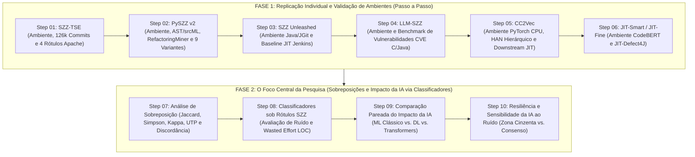

# Protocolo de Execução Experimental e Rastreabilidade Sequencial (Branch-per-Step)

> [!IMPORTANT]
> **Registro de Governança (`DEC-007`)**: Este documento detalha a sequência metodológica exata seguida para alcançar os resultados empíricos da pesquisa. Cada etapa corresponde a uma branch Git atômica isolada, gerando um commit semântico coeso antes da integração à branch `main`.

---

## 🎯 Visão Geral da Sequência Experimental

Para responder com rigor às questões de pesquisa (**RQ1: Sobreposições**, **RQ2: Impacto da Rotulagem** e **RQ3: Impacto da IA**) e produzir as evidências para o artigo científico da banca de Dezembro e a Dissertação de Mestrado, o trabalho foi decomposto em **10 etapas sequenciais rastreáveis**, divididas em duas grandes fases.

---

## 📋 Detalhamento das 10 Etapas Experimentais

### Fase 1: Replicação Individual e Validação dos Ambientes

#### Etapa 01 — Replicação e Validação da Pesquisa 4 (`SZZ-TSE`)
* **Branch**: `step-01/setup-e-replicacao-szz-tse`
* **Objetivo Metodológico**: Configurar o ambiente isolado `.venv-szz-tse`, auditar os 126.526 commits dos 10 projetos Apache e verificar a distribuição dos 4 rótulos SZZ (`buggy_B2`, `buggy_AG`, `buggy_MA` e `buggy_RA`).
* **Entregáveis Técnicos**: Script de extração e validação dos dados em `experiments/01-szz-tse/`, tabela de distribuição por projeto e verificação de multicolinearidade (`collinearity.csv`).
* **Commit Semântico**: `feat(step-01): replicacao e extracao do dataset szz-tse (10 projetos apache)`

#### Etapa 02 — Replicação e Validação da Pesquisa 2 (`PySZZ v2`)
* **Branch**: `step-02/setup-e-replicacao-pyszz-v2`
* **Objetivo Metodológico**: Configurar o ambiente isolado `.venv-pyszz-v2`, validar dependências externas (`srcML`, `RefactoringMiner-2.0` e `git`) e executar as variantes SZZ (`B`, `AG`, `MA`, `L`, `R`, `RA`, `PD`, `A`, `DF`) sobre os repositórios de validação.
* **Entregáveis Técnicos**: Script de execução das variantes em `experiments/02-pyszz-v2/` e oráculo de validação informado por desenvolvedores.
* **Commit Semântico**: `feat(step-02): replicacao e extracao das variantes pyszz v2`

#### Etapa 03 — Replicação e Validação da Pesquisa 3 (`SZZ Unleashed`)
* **Branch**: `step-03/setup-e-replicacao-szz-unleashed`
* **Objetivo Metodológico**: Configurar o ambiente `.venv-szz-unleashed`, validar o fatJar (`szz_find_bug_introducers-0.1.jar`) e replicar a extração de métricas de acoplamento (CodeMaat) e predição JIT no Jenkins Core.
* **Entregáveis Técnicos**: Pipeline de inferência e validação em `experiments/03-szz-unleashed/` com `Stratified 10-Fold CV` vs `Online Change Classification (OCC)`.
* **Commit Semântico**: `feat(step-03): replicacao szz-unleashed e baseline jenkins`

#### Etapa 04 — Replicação e Validação da Pesquisa 1 (`LLM-SZZ`)
* **Branch**: `step-04/setup-e-replicacao-llm-szz`
* **Objetivo Metodológico**: Configurar o ambiente `.venv-llm-szz`, verificar a estrutura de prompt chaining reflexivo e executar a validação sobre o benchmark verificado de CVEs C/C++ (100 CVEs) e Java (69 CVEs).
* **Entregáveis Técnicos**: Módulo de inferência e verificação de métricas em `experiments/04-llm-szz/`.
* **Commit Semântico**: `feat(step-04): replicacao llm-szz e oraculos cve c/java`

#### Etapa 05 — Replicação e Validação da Pesquisa 5 (`CC2Vec`)
* **Branch**: `step-05/setup-e-replicacao-cc2vec`
* **Objetivo Metodológico**: Configurar o ambiente `.venv-cc2vec` (PyTorch em CPU), verificar a rede hierárquica de atenção (`WordRNN -> SentRNN -> HunkRNN`) e a camada de tensores neurais (`Neural Tensor Network`).
* **Entregáveis Técnicos**: Pipeline de extração de embeddings e replicação da tarefa downstream de predição JIT em `experiments/05-cc2vec/`.
* **Commit Semântico**: `feat(step-05): replicacao cc2vec e downstream jit defect prediction`

#### Etapa 06 — Replicação e Validação da Pesquisa 6 (`JIT-Smart` / `JIT-Fine`)
* **Branch**: `step-06/setup-e-replicacao-jit-smart`
* **Objetivo Metodológico**: Configurar o ambiente `.venv-jit-smart`, descompactar e mapear o benchmark canônico `JIT-Defect4J` (21 projetos Java) e validar o co-treinamento da arquitetura CodeBERT + DLN.
* **Entregáveis Técnicos**: Scripts de carregamento de dados e verificação de baselines em `experiments/06-jit-smart/`.
* **Commit Semântico**: `feat(step-06): replicacao jit-smart e baselines jit-defect4j`

---

### Fase 2: O Foco Central da Pesquisa (Sobreposições e Treinamento de Classificadores com IA)

#### Etapa 07 — Investigação de Sobreposição entre Resultados (*Overlap Analysis*)
* **Branch**: `step-07/analise-sobreposicao-resultados-szz`
* **Objetivo Metodológico**: Responder à **RQ1** calculando de forma cruzada:
  1. Índice de Similaridade de Jaccard ($J(A, B) = \frac{|A \cap B|}{|A \cup B|}$) e Coeficiente de Sobreposição de Szymkiewicz-Simpson ($\frac{|A \cap B|}{\min(|A|, |B|)}$) entre todas as variantes SZZ.
  2. Matriz de Concordância Inter-Rótulos via Kappa de Cohen ($\kappa$).
  3. Identificação de Unique True Positives ($UTP$) e quantificação da Zona de Discordância (commits classificados como bug por heurísticas mas filtrados como refatoração por métodos sintáticos/IA).
* **Entregáveis Técnicos**: Scripts e relatórios consolidados em `experiments/07-analise-sobreposicao/` com tabelas CSV e gráficos de interseção UpSet.
* **Commit Semântico**: `feat(step-07): analise de sobreposicao e matriz de concordancia inter-szz`

#### Etapa 08 — Treinamento de Classificadores sobre Rótulos SZZ (Impacto do Ruído)
* **Branch**: `step-08/classificadores-impacto-rotulagem-szz`
* **Objetivo Metodológico**: Responder à **RQ2** treinando uma bateria padronizada de classificadores (`Naive Bayes`, `Logistic Regression`, `Random Forest`, `XGBoost` e Rede Neural/MLP) separadamente sobre os rótulos de cada variante SZZ (`B`, `AG`, `MA`, `RA`, `SZZ Unleashed` e `LLM-SZZ`).
* **Entregáveis Técnicos**: Scripts de treino e avaliação contra o oráculo limpo em `experiments/08-classificadores-rotulagem/`, mensurando a variação em `AUC`, `F1`, `G-Mean` e o esforço desperdiçado (`Wasted Effort LOC`, `Recall@20%Effort`, $P_{\text{opt}}$).
* **Commit Semântico**: `feat(step-08): treino de classificadores e impacto da rotulagem szz`

#### Etapa 09 — Comparação Pareada do Impacto da IA na Predição e Localização
* **Branch**: `step-09/classificadores-impacto-arquiteturas-ia`
* **Objetivo Metodológico**: Responder à **RQ3** comparando o ganho marginal real proporcionado pela introdução da IA em 3 níveis tecnológicos sobre as mesmas partições do `JIT-Defect4J`:
  1. *Sem IA Profunda*: Classificadores clássicos em atributos manuais (`LApredict`, `Random Forest`, `JITLine`).
  2. *Deep Learning Pré-LLM*: `Deeper`, `DeepJIT` e `CC2Vec`.
  3. *Transformers e Co-Learning*: `JIT-Fine` e `JIT-Smart`.
* **Entregáveis Técnicos**: Pipeline de treino unificado e tabelas de ganho incremental ($\Delta\%$) em nível de commit e linha em `experiments/09-impacto-arquiteturas-ia/`.
* **Commit Semântico**: `feat(step-09): comparacao do impacto de ia (ml classico vs dl vs transformers)`

#### Etapa 10 — Análise de Sensibilidade e Resiliência da IA ao Ruído (Zona Cinzenta vs. Consenso)
* **Branch**: `step-10/resiliencia-ia-zona-consenso-divergencia`
* **Objetivo Metodológico**: Avaliar o comportamento de modelos clássicos vs. modelos baseados em IA quando treinados e testados especificamente nos conjuntos onde os algoritmos SZZ concordam plenamente (*consenso*) versus onde divergem amplamente (*zona cinzenta de ruído/refatoração*).
* **Entregáveis Técnicos**: Relatório de sensibilidade e testes estatísticos não-paramétricos (Wilcoxon Signed-Rank, Cliff's Delta, Scott-Knott ESD) em `experiments/10-sensibilidade-ruido/`.
* **Commit Semântico**: `feat(step-10): analise de sensibilidade e resiliencia ao ruido na divergencia`

---

## 📌 Rastreabilidade para o Artigo Científico e Dissertação

| Seção do Artigo | Fontes de Evidência e Etapas Rastreáveis |
| :--- | :--- |
| **Metodologia (Data Collection)** | Etapas 01 a 06 (`docs/01-fichas-individuais/` e scripts de replicação). |
| **RQ1: Sobreposição dos Métodos** | Etapa 07 (`experiments/07-analise-sobreposicao/`). |
| **RQ2: Impacto da Rotulagem SZZ** | Etapa 08 (`experiments/08-classificadores-rotulagem/`). |
| **RQ3: Impacto das Arquiteturas de IA** | Etapa 09 e Etapa 10 (`experiments/09-*/` e `experiments/10-*/`). |
| **Ameaças à Validade** | `docs/04-governanca/diario-de-decisoes.md` (`DEC-001` a `DEC-007`). |
