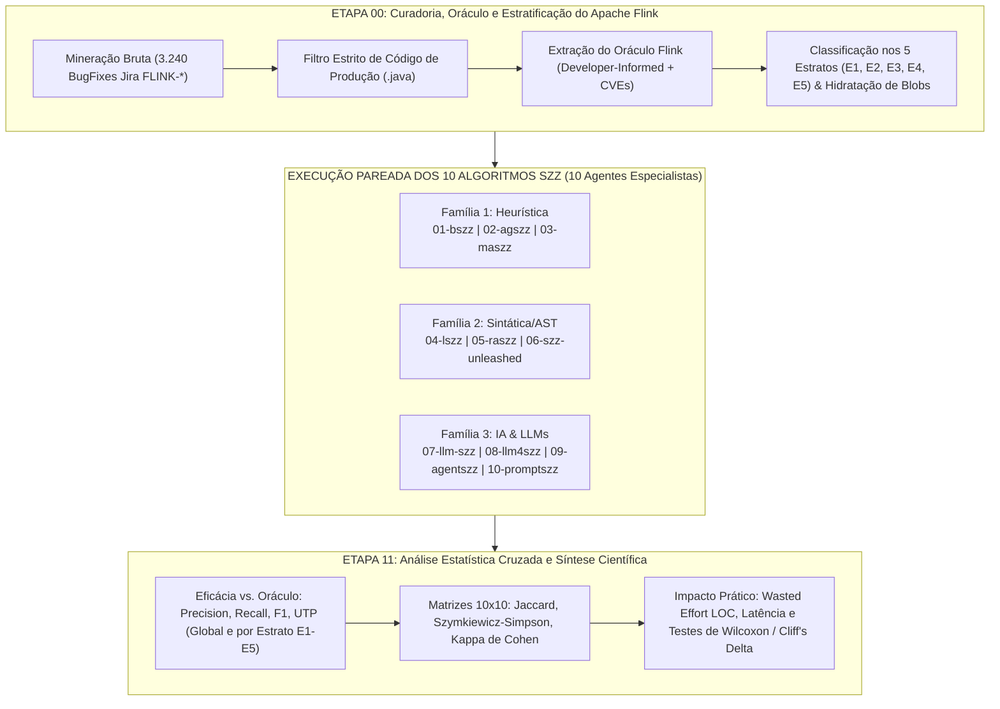

# Protocolo de Execução Experimental e Rastreabilidade Científica (10 Algoritmos SZZ no Apache Flink)

> [!IMPORTANT]
> **Registro de Governança (`DEC-007`, `DEC-008`, `DEC-009`, `DEC-010`, `DEC-011`)**: Este documento define o protocolo experimental canônico da pesquisa de Mestrado, alinhando simetricamente os **10 Algoritmos SZZ**, os **10 Agentes Especialistas (`expert-01-bszz` a `expert-10-promptszz`)** e a base unificada **Apache Flink (`repos/00-flink`)**.

---

## 🎯 1. Visão Geral da Arquitetura Experimental

Para responder com rigor às questões de pesquisa:
- **RQ1 (Eficácia por Estrato de Complexidade E1–E5)**: Qual é a Precisão, Recall, F1-Score e *Unique True Positives (UTP)* de cada um dos 10 algoritmos SZZ frente ao Oráculo Verificado do Apache Flink em cada estrato de falha?
- **RQ2 (Sobreposição, Concordância e Divergência Inter-Famílias)**: Qual o grau de concordância (*Jaccard*, *Szymkiewicz-Simpson*, *Kappa de Cohen*) entre as famílias Heurística (`01–03`), Sintática (`04–06`) e Baseada em LLMs (`07–10`)?
- **RQ3 (Esforço Desperdiçado e Custo-Benefício da IA)**: Quanto esforço de inspeção (*Wasted Effort LOC*) e ruído de falsos positivos as abordagens sintáticas e de LLM economizam em relação ao custo de latência/inferência?



---

## 🏛️ 2. Simetria Canônica do Repositório (`00` a `10`)

| ID | Algoritmo SZZ | Família | Repositório Local | Ficha Técnica | Agente Especialista | Estrato Alvo |
| :-: | :--- | :--- | :--- | :--- | :--- | :-: |
| **00** | **Apache Flink** | Base Unificada | `repos/00-flink/` | — | `skill-env-flink-benchmark` | **E1–E5** |
| **01** | **B-SZZ** | Heurística | `repos/01-bszz/` | `01-ficha-bszz.md` | `expert-01-bszz` | **E1** |
| **02** | **AG-SZZ** | Heurística | `repos/02-agszz/` | `02-ficha-agszz.md` | `expert-02-agszz` | **E2** |
| **03** | **MA-SZZ** | Heurística | `repos/03-maszz/` | `03-ficha-maszz.md` | `expert-03-maszz` | **E2 / E3** |
| **04** | **L-SZZ** | Sintática (`srcML`) | `repos/04-lszz/` | `04-ficha-lszz.md` | `expert-04-lszz` | **E2 / E4** |
| **05** | **RA-SZZ** | Sintática (`RefMiner`) | `repos/05-raszz/` | `05-ficha-raszz.md` | `expert-05-raszz` | **E3** |
| **06** | **SZZ Unleashed** | Sintática (`JGit`) | `repos/06-szz-unleashed/` | `06-ficha-szz-unleashed.md` | `expert-06-szz-unleashed` | **E3** |
| **07** | **LLM-SZZ** | LLM Chaining | `repos/07-llm-szz/` | `07-ficha-llm-szz.md` | `expert-07-llm-szz` | **E4 / E5** |
| **08** | **LLM4SZZ** | LLM Line-Ranking | `repos/08-llm4szz/` | `08-ficha-llm4szz.md` | `expert-08-llm4szz` | **E4** |
| **09** | **AgentSZZ** | LLM ReAct Agent | `repos/09-agentszz/` | `09-ficha-agentszz.md` | `expert-09-agentszz` | **E3 / E5** |
| **10** | **Prompt-SZZ** | LLM Zero-Shot CoT | `repos/10-promptszz/` | `10-ficha-promptszz.md` | `expert-10-promptszz` | **E1 / E2** |

---

## 🔬 3. Taxonomia dos 5 Estratos de Avaliação no Apache Flink (`E1` a `E5`)

1. **Estrato E1 — Bugs Atômicos & Diretos (*Single-Hunk Logic Modification*)**:
   - Correções cirúrgicas em 1 arquivo `.java` de produção ($\le 5$ linhas deletadas) sem ruído cosmético ou refatoração.
2. **Estrato E2 — Ruído Cosmético, Javadoc & Anotações (*Cosmetic & Metadata Noise*)**:
   - Commits que misturam correção de lógica com alterações de comentários, cabeçalhos de licença, linhas em branco ou anotações (`@Override`, `@Nullable`, `@PublicEvolving`).
3. **Estrato E3 — Refatorações Estruturais & Evolução Multi-Salto (*Structural Refactoring & Line Movement*)**:
   - Correções cujo código-alvo sofreu *Extract Method*, *Rename*, *Move* ou re-numeração de linhas em commits intermediários antes do fix.
4. **Estrato E4 — *Tangled Commits* (*Multi-Purpose / Large Patches*)**:
   - Patches extensos que modificam múltiplos arquivos/métodos (ex.: $\ge 3$ classes ou $> 25$ linhas deletadas), onde apenas uma fração das linhas alteradas contém a causa raiz do bug.
5. **Estrato E5 — Correções por Adição Pura & Bugs Multi-Arquivo (*Add-Only & Cross-Component Fixes*)**:
   - Correções defensivas onde $0$ linhas de código Java foram deletadas (`deleted_lines == 0`, ex.: adição de `if (x == null)` ou `Preconditions.checkState`) ou onde a causa raiz reside em contrato de componente distinto.

---

## 📊 4. Contrato Padronizado de Saída (`experiments/<ID>/predictions.json`)

Todos os 10 algoritmos exportam suas predições no mesmo esquema JSON para auditoria direta pelo módulo `experiments/11-analise-cruzada/evaluate_and_compare_10_szz.py`:

```json
{
  "algorithm_id": "05-raszz",
  "algorithm_name": "RA-SZZ (RefactoringMiner 2.0)",
  "family": "Syntactic",
  "benchmark": "apache/flink",
  "results": [
    {
      "fix_commit_hash": "<sha1>",
      "issue_id": "FLINK-XXXXX",
      "stratum": "E3",
      "ground_truth_bics": ["<oracle_sha1>"],
      "predicted_bics": ["<pred_sha1>"],
      "latency_sec": 1.42,
      "reasoning_or_metadata": "Filtered 2 Extract Method refactorings"
    }
  ]
}
```
