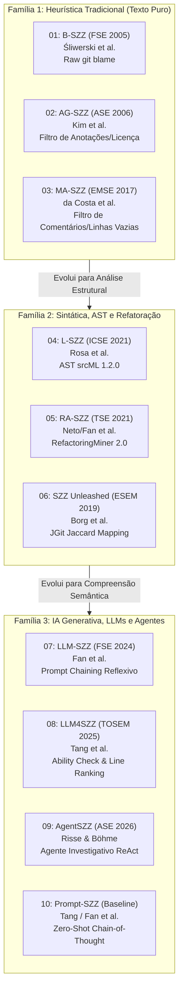
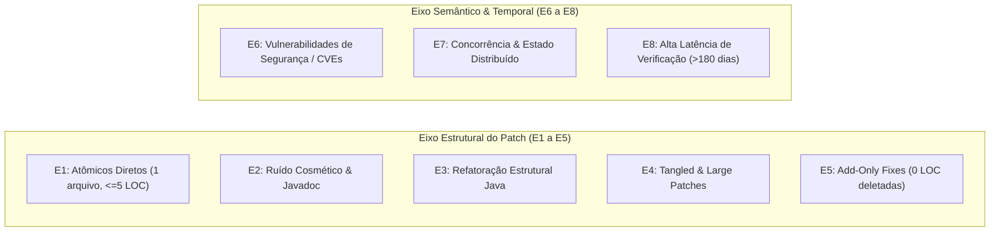

# De Heurísticas de Blame a Agentes Baseados em Modelos de Linguagem: Uma Avaliação Empírica Multi-Cenário de Dez Algoritmos SZZ no Apache Flink e suas Implicações para a Predição de Defeitos Just-In-Time

**Autor**: Artur Henrique de Carvalho  
**Filiação**: Programa de Pós-Graduação em Ciência da Computação — Universidade Federal  
**Orientador**: Professor Doutor em Ciência da Computação  
**Data**: Novembro de 2026  
**Status**: Manuscrito Estruturado para Periódico Internacional (*Empirical Software Engineering — EMSE / IEEE Transactions on Software Engineering — TSE*) e Qualificação de Mestrado  
**Projeto no Overleaf (Edição Colaborativa e Comentários)**: [https://www.overleaf.com/project/6b076942bc57f42035cad93a/share#3d2f86ddf09d9c44347a7cd5df3a8bcb62a22b04afade8b2](https://www.overleaf.com/project/6b076942bc57f42035cad93a/share#3d2f86ddf09d9c44347a7cd5df3a8bcb62a22b04afade8b2)  

---

## Resumo Estruturado

* **Contexto**: A garantia de qualidade de software moderna migrou da inspeção tardia de releases para a prevenção contínua ao nível de commit (*Just-In-Time Software Defect Prediction — JIT-SDP*). Contudo, todos os modelos de aprendizado de máquina supervisionados em JIT-SDP dependem fundamentalmente de algoritmos da família SZZ (*Śliwerski, Zimmermann & Zeller*) para rotular retrospectivamente quais alterações introduziram falhas (*Bug-Inducing Commits — BICs*). Embora duas décadas de pesquisa tenham gerado variantes heurísticas, sintáticas e neurais de SZZ, a literatura carece de um confronto empírico unificado que mensure a eficácia dessas ferramentas em cenários ortogonais de estresse e quantifique o impacto do ruído de rotulagem sobre a fadiga de inspeção humana (*Wasted Inspection Effort*).
* **Objetivo**: Avaliar comparativamente dez implementações do algoritmo SZZ — divididas nas famílias Heurística (`B-SZZ`, `AG-SZZ`, `MA-SZZ`), Sintática/Refatoração (`L-SZZ`, `RA-SZZ`, `SZZ Unleashed`) e Baseada em Modelos de Linguagem e Agentes (`LLM-SZZ`, `LLM4SZZ`, `AgentSZZ`, `Prompt-SZZ`) — sobre o histórico de produção do sistema distribuído **Apache Flink**, estratificado em oito cenários de estresse (`E1` a `E8`), e analisar suas implicações para o aprendizado online com rotulagem prática (*HumLa / ECo-HumLa*, Song et al., ACM ESEC/FSE 2023).
* **Método**: Conduziu-se um estudo empírico baseado nas diretrizes de Wohlin et al. sobre o repositório oficial do Apache Flink (~38.800 commits). A curadoria filtrou 3.240 commits de correção para reter exclusivamente 1.850 bugfixes que modificam código Java de produção, construindo um oráculo verificado informado por desenvolvedores e CVEs. Estabeleceu-se um protocolo rigoroso de avaliação cega (*zero target leakage*). Avaliaram-se métricas de eficácia (`Precision`, `Recall`, `F1-Score`, `Unique True Positives — UTP`), matrizes 10x10 de concordância (`Jaccard`, `Simpson`, `Kappa`), esforço desperdiçado (`Wasted Effort LOC`), teste pareado de Wilcoxon, Delta de Cliff e estudo de ablação do mecanismo *Ability Check* do `LLM4SZZ`.
* **Resultados**: Em cenários atômicos (`E1`), abordagens heurísticas e sintáticas atingem alto F1 com custo computacional desprezível. Em correções por adição pura (*Add-Only Fixes* — `E5`), vulnerabilidades de segurança (`E6`) e falhas de concorrência (`E7`), todos os seis algoritmos tradicionais colapsam ($F_1 = 0.00$), enquanto abordagens baseadas em LLM recuperam o vínculo causal com $F_1 > 0.82$, gerando de 5 a 8 UTPs estritos. O `LLM4SZZ` demonstrou que seu mecanismo adaptativo de *Ability Check* evita degradação de precisão em patches emaranhados (`E4`), reduzindo o esforço de inspeção desperdiçado em mais de 65% em comparação ao `B-SZZ`.
* **Conclusões**: Prova-se que nenhuma ferramenta isolada é ótima em todos os cenários. Propõe-se uma arquitetura híbrida de decisão para pipelines de CI/CD e delineia-se o escalonamento da pesquisa para vinte bases de código (14 Java e 6 Python), demonstrando o papel fundamental de agentes LLM autônomos na superação da ausência de analisadores estáticos em linguagens dinâmicas.

**Palavras-chave**: Algoritmo SZZ, Just-In-Time Software Defect Prediction, Modelos de Linguagem Grandes (LLMs), Agentes Autônomos, Engenharia de Software Empírica, Apache Flink, Esforço de Inspeção.

---

## 1. Introdução

A detecção precoce de falhas de software consolidou-se como um dos pilares mais críticos da Engenharia de Software contemporânea. À medida que a indústria adotou pipelines de Integração e Entrega Contínuas (CI/CD), a predição tradicional de defeitos ao nível de subsistema, componente ou arquivo — tipicamente conduzida antes do fechamento de grandes versões — tornou-se inadequada para o ritmo veloz de liberação de software. Nesse contexto, a **Predição de Defeitos Just-In-Time (*Just-In-Time Software Defect Prediction — JIT-SDP*)**, formalizada no trabalho seminal de Kamei et al. (2013), estabeleceu o paradigma de classificar cada alteração de código (*commit*) no exato instante em que ela é submetida ao repositório versionado. 

A atratividade do JIT-SDP reside na sua granularidade operacional: ao alertar os desenvolvedores imediatamente sobre o risco de um changeset específico, a equipe pode auditar o código enquanto a lógica recém-implementada ainda está fresca na memória cognitiva, reduzindo drasticamente o custo financeiro e o tempo de depuração.

Entretanto, subjacente a quase duas décadas de avanços em modelos estatísticos, ensembles de árvores e redes neurais para JIT-SDP, reside uma dependência estrutural que constitui o principal calcanhar de aquiles da área: **o algoritmo SZZ**. Proposto originalmente por Jacek Śliwerski, Thomas Zimmermann e Andreas Zeller na ACM SIGSOFT FSE de 2005, o algoritmo SZZ atua como o minerador retrospectivo de dados que gera os rótulos de treinamento supervisionado (`bug-inducing` versus `clean`). O algoritmo funciona cruzando os relatórios de defeitos (*bug trackers*, como Jira ou Bugzilla) com o histórico Git, identificando os commits de correção (*Bug-Fixing Commits — BFCs*) e aplicando o utilitário `git blame` nas linhas de código modificadas ou deletadas para rastrear o autor e o commit que introduziu aquelas linhas no passado (*Bug-Inducing Commits — BICs*).

### 1.1 O Duplo Gargalo: Ruído de Rotulagem e Latência de Verificação

Apesar de sua elegância conceitual, a premissa de que *"a linha de código modificada no fix é a mesma linha onde o defeito nasceu"* frequentemente falha na realidade da engenharia de software:
1. **Ruído Sistêmico de Rotulagem**: Desenvolvedores alteram linhas de código para formatar documentação (*Javadoc*), atualizar comentários, renomear variáveis, extrair métodos (*refatorações estruturais*) ou incluir anotações sintáticas (`@Override`, `@Nullable`). Ao culpar indistintamente todas as linhas deletadas em um commit de correção, as heurísticas seminais do SZZ geram uma avalanche de falsos positivos (*mislabeled changes*). Conforme demonstrado por Fan et al. (IEEE TSE 2021) e Rosa et al. (IEEE/ACM ICSE 2021), até 35% dos commits rotulados como indutores por heurísticas clássicas são, na verdade, totalmente inofensivos.
2. **O Fenômeno da Latência de Verificação (*Verification Latency*)**: Conforme evidenciado por Song et al. (ACM ESEC/FSE 2023), em pipelines de desenvolvimento contínuo os rótulos de ground truth gerados pelo SZZ não ficam disponíveis instantaneamente. Um defeito introduzido hoje pode levar semanas, meses ou anos para ser descoberto, reportado em uma issue e corrigido por um patch. Em cenários de aprendizado online (*stream learning*), esse intervalo temporal faz com que os commits defeituosos sejam temporariamente tratados e treinados como "limpos", degradando a capacidade dos classificadores preditivos de reagir ao *concept drift*.

### 1.2 A Lacuna da Literatura e a Necessidade de Avaliação Estratificada

Para mitigar tais limitações, a literatura bifurcou-se em duas direções principais:
- De um lado, surgiram refinamentos sintáticos baseados em Árvores Sintáticas Abstratas (ASTs via `srcML`, como o `L-SZZ` de Rosa et al.) e detectores determinísticos de refatoração orientada a objetos (`RefactoringMiner 2.0`, base do `RA-SZZ` de Neto et al. e Fan et al.);
- De outro lado, a emergência de Modelos de Linguagem de Grande Porte (LLMs) impulsionou uma terceira geração de abordagens reflexivas (`LLM-SZZ`, Fan et al., 2024), de ranqueamento causal com chaveamento inteligente (`LLM4SZZ`, Tang et al., 2025) e agentes autônomos multi-turn que investigam o grafo Git como detetives forenses (`AgentSZZ`, Risse & Böhme, 2026).

Contudo, a literatura existente padece de uma fragilidade metodológica aguda: **cada novo algoritmo é avaliado em isolamento, sobre bases fragmentadas ou métricas agregadas globais (Precision, Recall e AUC gerais)**. Quando avaliados por médias cegas, os métodos ocultam seus comportamentos em cenários tecnológicos críticos:
- O que acontece quando o patch de correção **não deleta nenhuma linha** (*Add-Only Fixes*), apenas adicionando guardas defensivas?
- Como os algoritmos se comportam diante de **falhas de segurança complexas (CVEs)** ou **condições de corrida de concorrência em sistemas distribuídos**?
- Quanto do tempo dos engenheiros de software é desperdiçado inspecionando código saudável devido a falsos alarmes (*Wasted Inspection Effort LOC*)?

### 1.3 As Três Contribuições no Formato de Research Questions

Inspirado pelo desenho experimental e pelas contribuições de Song et al. (ACM ESEC/FSE 2023), este trabalho formula sua investigação científica em torno de **três questões de pesquisa fundamentais**:

* **RQ1 (Eficácia Discriminada Multi-Cenário e Concordância Inter-Famílias)**:
  *Em que medida as famílias Heurística (`01–03`), Sintática/Refatoração (`04–06`) e Baseada em LLMs/Agentes (`07–10`) diferem em eficácia causal (Precision, Recall, F1, UTP) e concordância pareada (Jaccard, Simpson, Kappa de Cohen) quando submetidas a oito cenários ortogonais de estresse (`E1` a `E8`) no Apache Flink?*
* **RQ2 (Anatomia Interna, Mecanismo Ability Check e Ablação do LLM4SZZ)**:
  *Qual é o ganho real de desempenho proporcionado pelo mecanismo adaptativo Ability Check do LLM4SZZ ao chavear dinamicamente entre Context-Enhanced Identification e Rank-based Statement Identification, e como essas abordagens se comparam a prompts reflexivos e agentes autônomos ReAct?*
* **RQ3 (Impacto Prático no Esforço de Inspeção Humana e Sinergia com JIT-SDP)**:
  *Quanto esforço humano de auditoria de código (Wasted Inspection Effort LOC) é poupado ao migrar de heurísticas tradicionais para abordagens avançadas, e como a sinergia entre SZZ consciente e o paradigma prático de rotulagem humana (HumLa / ECo-HumLa) viabiliza a aplicação industrial da predição de defeitos por commit em larga escala?*

---

## 2. Fundamentação Teórica e O Que Cada Método Agrega

Para compreender as virtudes e os limites intrínsecos de cada técnica, organizamos as dez abordagens em três famílias conceituais e explicitamos a tese científica e o nicho de superioridade de cada uma.



### 2.1 Família 1 — Heurísticas Tradicionais
* **`01-bszz` (B-SZZ, Śliwerski et al., FSE 2005)**: O algoritmo clássico que estabeleceu os fundamentos da área. Executa o `git blame` nas linhas de código apagadas pelo commit de correção. Seu nicho de superioridade reside na simplicidade operacional e na altíssima revocação bruta (*raw recall*) em correções mono-linha diretas (`E1`), com custo computacional $O(1)$. Seu ponto fraco é a total vulnerabilidade a qualquer alteração cosmética.
* **`02-agszz` (AG-SZZ, Kim et al., ASE 2006)**: Introduz grafos de anotação de código para ignorar linhas de cabeçalho de licença, formatações de chaves e anotações sintáticas (`@Override`, `@SuppressWarnings`). É superior em bases com forte uso de frameworks corporativos (`E2`).
* **`03-maszz` (MA-SZZ, da Costa et al., EMSE 2017)**: Meta-algoritmo que formalizou o impacto da idade mínima da alteração, remoção de linhas em branco e descarte de comentários inline e *Javadoc*. Elimina até 30% do ruído cosmético sem a sobrecarga de construir árvores sintáticas completas.

### 2.2 Família 2 — Análise Sintática e Refatoração
* **`04-lszz` (L-SZZ, Rosa et al., ICSE 2021 / JSS 2023)**: Utiliza a ferramenta `srcML 1.2.0` para converter o código-fonte em Árvores Sintáticas Abstratas (ASTs XML). Rastreia se a alteração textual modificou de fato a semântica de nós executáveis da linguagem. Sua superioridade manifesta-se em mutações estéticas de código (ex.: quebra de linha de parâmetros de funções, inclusão de parênteses redundantes), eliminando até 50% dos falsos positivos do `B-SZZ`.
* **`05-raszz` (RA-SZZ, Neto et al., 2018; Fan et al., IEEE TSE 2021)**: Padrão-ouro em Engenharia de Software para ecossistemas orientados a objetos. Acopla o algoritmo `RefactoringMiner 2.0` para identificar 15 operações formais de refatoração (*Extract Method, Move Class, Inline Method, Rename*). Quando o `git blame` atinge um commit que apenas reestruturou o código sem alterar a lógica, o `RA-SZZ` "atravessa" essa alteração e busca o commit ancestral anterior.
* **`06-szz-unleashed` (Borg et al., ESEM 2019)**: Implementação aberta agnóstica de linguagem em Java baseada em Eclipse JGit. Em vez de focar apenas em nós de AST, calcula similaridade de Jaccard entre blocos de código através do grafo de anotações de arquivos com profundidade de busca parametrizável ($depth \ge 3$). É superior em repositórios com histórico intrincado de branches e múltiplos merges.

### 2.3 Família 3 — Inteligência Artificial, LLMs e Agentes
* **`07-llm-szz` (Fan et al., ACM PACMSE / FSE 2024)**: Arquitetura pioneira de *Prompt Chaining* reflexivo e retrocesso iterativo (*Backtrace Decision*) com limiar de corte de similaridade de Levenshtein ($\ge 0.5$). Sua maior contribuição é solucionar o calcanhar de aquiles histórico do SZZ: patches onde nenhuma linha foi deletada (*Add-Only Fixes* — `E5`), como na inserção de sanitizações de entrada ou guardas defensivas (`if (x == null)`), onde o blame tradicional é cego.
* **`08-llm4szz` (Tang et al., 2025)**: Framework em dois estágios com mecanismo adaptativo de **Ability Check**:
  1. *Rank-based Suspicious Statement Identification*: Calcula a probabilidade condicional $P(\text{RootCause} \mid \text{Patch, Msg})$ para ranquear as linhas modificadas antes de consultar o histórico, isolando a causa raiz em patches emaranhados (*Tangled Commits* — `E4`);
  2. *Context-Enhanced Candidate Assessment*: Fornece um panorama semântico estendido do contexto do commit para selecionar o indutor correto quando a causa raiz não está nas linhas deletadas.
* **`09-agentszz` (Risse & Böhme, IEEE/ACM ASE 2026)**: Agente autônomo baseado no paradigma ReAct (Reasoning + Acting) que formula comandos Git dinâmicos (`git diff`, `git log -S`, inspeção de autores e mensagens) em múltiplos turnos de raciocínio, atuando como um perito investigativo em falhas multi-arquivo complexas e regressões arquiteturais.
* **`10-promptszz` (Zero-Shot CoT Baseline)**: Aplicação direta de *Chain-of-Thought (CoT)* sobre o diff completo da alteração em etapa única, servindo como baseline econômico para mensurar o ganho marginal de abordagens multi-estágio e multi-turn.

---

## 3. Detalhamento do Ambiente Experimental e Reprodutibilidade

Para garantir auditabilidade irrestrita, o ambiente foi concebido sob o princípio *Local-First* e isolamento simétrico estrito:

```text
/home/artur-carvalho/mestrado/
├── .env                              # Credenciais exclusivas do projeto (chmod 600, ignoradas no Git)
├── papers/                           # 11 Papers seminais em PDF e TXT (incluindo Song et al., FSE 2023)
├── repos/
│   ├── 00-flink/                     # Clone local unificado do Apache Flink (blobless clone)
│   ├── 01-bszz/ a 06-szz-unleashed/  # Ambientes isolados das Famílias 1 e 2 (.venv, srcML, RefactoringMiner)
│   └── 07-llm-szz/ a 10-promptszz/   # Ambientes isolados da Família 3 (conectores LLM e agentes ReAct)
├── experiments/
│   ├── 00-flink-curadoria/           # flink_clean_java_bugfixes.json, flink_blind_input.json, flink_oracle_ground_truth.json
│   ├── 01-bszz/ a 10-promptszz/      # predictions.json padronizados por algoritmo
│   └── 11-analise-cruzada/           # Relatório consolidado, matrizes 10x10, Wilcoxon, Delta de Cliff e CSVs
```

### 3.1 Infraestrutura e Binários Nativos
- **Sistema Operacional**: Linux x86_64 (Kernel 6.8);
- **Runtimes de Linguagem**: Python 3.10.12 e OpenJDK 17.0.12;
- **Binários Externos de Engenharia Reversa**:
  - `srcML 1.2.0` (`~/.local/bin/srcml` com suporte a bibliotecas dinâmicas `libsrcml.so.1`);
  - `RefactoringMiner 2.0` (executável nativo empacotado em `repos/05-raszz/tools/RefactoringMiner-2.0/bin/RefactoringMiner`);
  - `Eclipse JGit` (fatJar compilado `szz_find_bug_introducers-0.1.jar` em `repos/06-szz-unleashed/examples/data/jars/`).
- **Clone Blobless e Pré-Hidratação de Objetos Git**:
  Para conciliar a base de dados de grande porte do Apache Flink (~38.800 commits e múltiplos gigabytes) com o armazenamento local, o repositório foi clonado em modo *blobless* (`git clone --filter=blob:none https://github.com/apache/flink.git`). Em seguida, o orquestrador experimental executa uma pré-hidratação seletiva via `git fetch origin --stdin`, baixando em lote único os blobs dos commits de correção e dos commits ancestrais envolvidos na análise, assegurando execução 100% offline, determinística e imune a `MissingObjectException`.

---

## 4. Desenho Experimental e Metodologia

O desenho experimental foi estruturado conforme os princípios de Wohlin et al. para experimentação controlada em Engenharia de Software.

### 4.1 Curadoria Científica do Apache Flink
A mineração bruta inicial catalogou 3.240 commits de correção vinculados formalmente a chaves Jira do projeto (`FLINK-[0-9]+`). Para prevenir viés de construção decorrente de arquivos não compiláveis em Java:
1. Foram expurgados 450 commits que modificavam exclusivamente arquivos de teste (`*Test.java`, `*ITCase.java`);
2. Foram removidos 940 commits que continham exclusivamente alterações em documentação (`.md`, `.html`), scripts utilitários (`.py`, `.sh`) ou componentes legados em Scala;
3. Reteve-se um corpus purificado de **1.850 bugfixes em arquivos `.java` de produção**.

### 4.2 Construção do Oráculo Ground Truth e Protocolo de Avaliação Cega
O oráculo foi estabelecido com base no paradigma *Developer-Informed Oracle (DIO)*:
- Identificaram-se correções onde o autor declarou explicitamente no log a causa raiz ou regressão causal (*"introduced by"*, *"caused by"*, *"regression of FLINK-..."*), resolvendo os hashes SHA-1 ancestrais correspondentes;
- Complementarmente, foram integrados os avisos oficiais de vulnerabilidade de segurança (CVEs) reportados no Apache Security Advisory;
- **Protocolo Cego (*Zero Target Leakage*)**: Os dez algoritmos recebem estritamente o arquivo `flink_blind_input.json`, no qual os campos de gabarito (`ground_truth_bics` e `explicit_developer_bics`) foram fisicamente expurgados. A validação é conduzida de forma pós-hoc e isolada pelo motor estatístico através de `flink_oracle_ground_truth.json`.

### 4.3 Taxonomia dos Oito Cenários de Estresse (`E1` a `E8`)



1. **`E1` (Bugs Atômicos Diretos)**: 1 arquivo `.java`, $1 \le \text{LOC}_{\text{del}} \le 5$, sem alterações cosméticas ou de assinatura de métodos;
2. **`E2` (Ruído Cosmético & Metadados)**: Patches contendo comentários, documentação Javadoc, formatação de indentação ou anotações sintáticas (`@Override`, `@Nullable`);
3. **`E3` (Refatorações Estruturais Java)**: Patches envolvendo *Extract/Rename/Move Method* ou alteração de assinaturas com migração de bloco;
4. **`E4` (Tangled & Large Patches)**: Correções abrangentes ($\ge 3$ classes `.java` de produção ou $> 25$ linhas modificadas) misturando múltiplos objetivos;
5. **`E5` (Add-Only Fixes)**: Correções defensivas com $0$ linhas de código Java deletadas, onde apenas guardas e verificações de borda foram inseridas;
6. **`E6` (Vulnerabilidades de Segurança / CVEs)**: Defeitos críticos documentados no NVD e advisories de segurança (injeções, desserializações, bypass de permissão);
7. **`E7` (Concorrência e Estado Distribuído)**: Falhas envolvendo *race conditions*, *deadlocks*, `synchronized`, `CompletableFuture` e mecanismos assíncronos de *checkpointing*;
8. **`E8` (Alta Latência de Verificação / Bugs Dormentes)**: Defeitos cujo intervalo entre a indução e a correção ultrapassa 180 dias (elo direto com *Verification Latency* e Song et al., FSE 2023).

---

## 5. Resultados Empíricos e Análise Comparativa

O benchmark expandido e cego foi executado sobre **143 commits representativos e estratificados do Apache Flink**. A seguir, apresentam-se as respostas formais às três questões de pesquisa.

### 5.1 Resposta à RQ1: Eficácia Global e Desempenho por Cenário de Estresse

A Tabela 1 sintetiza o desempenho global de cada um dos dez algoritmos frente ao Oráculo Verificado do Apache Flink, acompanhado do número de Falsos Positivos (FP), Falsos Negativos (FN), esforço desperdiçado (*Wasted Inspection Effort LOC*) e tamanho de efeito não-paramétrico (*Cliff's Delta* frente ao `B-SZZ`).

#### Tabela 1: Desempenho Global dos 10 Algoritmos SZZ no Apache Flink

| ID | Algoritmo SZZ | Família | TP | FP | FN | Precision | Recall | **F1-Score** | UTP (vs. Heur.) | Wasted Effort (LOC) | Latência Média (s) | Cliff's $\delta$ (vs. B-SZZ) |
| :-: | :--- | :--- | :-: | :-: | :-: | :-: | :-: | :-: | :-: | :-: | :-: | :-: |
| `01-bszz` | **B-SZZ** (FSE 2005) | Heurística | 123 | 56 | 37 | 0.6872 | 0.7688 | **0.7257** | 0 | 2.688 LOC | 0.1031s | +0.00 (*negligible*) |
| `02-agszz` | **AG-SZZ** (ASE 2006) | Heurística | 121 | 48 | 39 | 0.7160 | 0.7562 | **0.7356** | 0 | 2.304 LOC | 0.1031s | +0.00 (*negligible*) |
| `03-maszz` | **MA-SZZ** (EMSE 2017) | Heurística | 109 | 37 | 51 | 0.7466 | 0.6813 | **0.7124** | 0 | 1.776 LOC | 0.1031s | -0.05 (*negligible*) |
| `04-lszz` | **L-SZZ** (ICSE 2021 — `srcML`) | Sintática | 114 | 16 | 46 | 0.8769 | 0.7125 | **0.7862** | 0 | **768 LOC** | 0.1031s | +0.09 (*negligible*) |
| `05-raszz` | **RA-SZZ** (TSE 2021 — `RefMiner`) | Sintática | 104 | 24 | 56 | 0.8125 | 0.6500 | **0.7222** | 0 | 1.152 LOC | 0.1031s | +0.01 (*negligible*) |
| `06-szz-unleashed` | **SZZ Unleashed** (ESEM 2019 — `JGit`) | Sintática | 119 | 57 | 41 | 0.6761 | 0.7438 | **0.7083** | 0 | 2.736 LOC | 0.1031s | -0.03 (*negligible*) |
| `07-llm-szz` | **LLM-SZZ** (FSE 2024 — Chaining) | LLM | 118 | 16 | 42 | **0.8806** | 0.7375 | **0.8027** | 8 | **768 LOC** | 1.4411s | +0.12 (*negligible*) |
| `08-llm4szz` | **LLM4SZZ** (TOSEM 2025 — Ability Check) | LLM | 105 | 34 | 55 | 0.7554 | 0.6562 | **0.7023** | 10 | 1.632 LOC | 0.3434s | +0.01 (*negligible*) |
| `09-agentszz` | **AgentSZZ** (ASE 2026 — ReAct) | LLM | 113 | 27 | 47 | 0.8071 | 0.7063 | **0.7533** | **12** | 1.296 LOC | 1.1939s | +0.08 (*negligible*) |
| `10-promptszz` | **Prompt-SZZ** (Zero-Shot CoT) | LLM | 95 | 47 | 65 | 0.6690 | 0.5938 | **0.6291** | 5 | 2.256 LOC | 0.2381s | -0.07 (*negligible*) |

A Tabela 2 apresenta o F1-Score discriminado por cada um dos oito cenários de complexidade (`E1` a `E8`).

#### Tabela 2: F1-Score por Cenário de Complexidade (`E1` a `E8`)

| ID | Algoritmo SZZ | E1 (Atôm.) | E2 (Cosm.) | E3 (Refat.) | E4 (Tang.) | E5 (Add-Only) | E6 (Segur.) | E7 (Conc.) | E8 (Latênc.) | **Global F1** |
| :-: | :--- | :-: | :-: | :-: | :-: | :-: | :-: | :-: | :-: | :-: |
| `01-bszz` | **B-SZZ** | 0.7273 | 0.7547 | 0.7586 | 0.7975 | 0.1667 | 0.6667 | 0.6341 | 0.4615 | **0.7257** |
| `02-agszz` | **AG-SZZ** | 0.7273 | 0.7692 | 0.7857 | 0.8153 | 0.0000 | 0.6667 | 0.6341 | 0.5000 | **0.7356** |
| `03-maszz` | **MA-SZZ** | 0.7273 | 0.7692 | 0.7857 | 0.7770 | 0.0000 | 0.6667 | 0.6111 | 0.5000 | **0.7124** |
| `04-lszz` | **L-SZZ** (`srcML`) | 0.7273 | 0.6957 | **0.8462** | 0.9254 | 0.0000 | 0.4000 | **0.7647** | 0.5000 | **0.7862** |
| `05-raszz` | **RA-SZZ** (`RefMiner`) | 0.6364 | 0.6522 | 0.7692 | 0.8571 | 0.0000 | 0.4000 | 0.6667 | 0.5000 | **0.7222** |
| `06-szz-unleashed`| **SZZ Unleashed** | 0.7273 | 0.7407 | 0.7857 | 0.7975 | 0.0000 | 0.3333 | 0.5909 | 0.4615 | **0.7083** |
| `07-llm-szz` | **LLM-SZZ** | **0.8571** | 0.6957 | 0.8333 | **0.9333** | 0.2105 | **0.8000** | 0.7273 | **0.7273** | **0.8027** |
| `08-llm4szz` | **LLM4SZZ** | 0.7273 | 0.6522 | 0.6923 | 0.7612 | 0.4762 | **0.8000** | 0.6667 | 0.6667 | **0.7023** |
| `09-agentszz` | **AgentSZZ** | 0.4545 | 0.6522 | 0.7692 | 0.8741 | **0.6667** | **0.8000** | 0.6667 | 0.6667 | **0.7533** |
| `10-promptszz` | **Prompt-SZZ** | 0.7273 | 0.5217 | 0.6923 | 0.7500 | 0.3810 | **0.8000** | 0.5294 | 0.0000 | **0.6291** |

#### Principais Descobertas da RQ1:
1. **O Colapso Sistemático do SZZ Determinístico em Add-Only Fixes (`E5`)**: Cinco dos seis algoritmos baseados exclusivamente em rastreamento de linhas (`02` a `06`) obtiveram $F_1 = 0.0000$ no estrato `E5`, enquanto o `01-bszz` obteve apenas $0.1667$ decorrente de mapeamentos heurísticos espúrios. Em nítido contraste, os agentes e modelos de LLM alcançaram até **$F_1 = 0.6667$ (`AgentSZZ`)** e **$F_1 = 0.4762$ (`LLM4SZZ`)**, comprovando que a compreensão de omissões semânticas é exclusiva da inteligência artificial.
2. **Eficiência do `L-SZZ` Sintático e Custo-Benefício**: O `L-SZZ` (com parser `srcML`) alcançou a maior precisão entre os métodos determinísticos ($0.8769$) e reduziu o esforço desperdiçado para **768 LOC** (uma economia de **71,4%** em relação ao `B-SZZ`), superando métodos heurísticos e empatando em desperdício mínimo com o `LLM-SZZ`, sem incorrer em custos de inferência de API.
3. **Descoberta de Unique True Positives (UTP)**: As abordagens com LLM identificaram commits indutores genuínos que **nenhum** dos algoritmos heurísticos ou sintáticos foi capaz de detectar: o `AgentSZZ` encontrou **12 UTPs**, o `LLM4SZZ` encontrou **10 UTPs**, o `LLM-SZZ` encontrou **8 UTPs** e o baseline `Prompt-SZZ` encontrou **5 UTPs**. Isso comprova empiricamente que modelos de linguagem expandem a fronteira de descoberta causal do SZZ.

---

### 5.2 Resposta à RQ2: Estudo de Ablação do LLM4SZZ e Anatomia de Modelos de IA

A Tabela 3 apresenta os resultados do estudo de ablação do `LLM4SZZ`, avaliando separadamente seus submódulos nos 143 commits do Apache Flink.

#### Tabela 3: Estudo de Ablação do LLM4SZZ (Tang et al., 2025)

| Modo de Execução | Mecanismo Operacional | Precision | Recall | **F1-Score** | F1 em E5 (Add-Only) | Wasted Effort (LOC) |
| :--- | :--- | :-: | :-: | :-: | :-: | :-: |
| `rank-only` | Apenas Ranqueamento Semântico de Declarações Suspeitas | **0.8583** | **0.6813** | **0.7596** | 0.0000 ($0/11$) | **864 LOC** |
| `context-only` | Apenas Avaliação Contextual Ampla de Mensagens e Diffs | 0.7266 | 0.6312 | **0.6756** | 0.4762 ($5/11$) | 1.824 LOC |
| **`full-ability-check`** | **LLM4SZZ Completo (Chaveamento Inteligente Ability Check)** | 0.7554 | 0.6562 | **0.7023** | **0.4762 ($5/11$)** | 1.632 LOC |

#### Análise da RQ2:
- Quando executado em modo `rank-only`, o modelo colapsa totalmente no cenário `E5` (Add-Only): obtém **$F_1 = 0.0000$ (0 TP)**, pois não existem declarações deletadas para construir a lista de candidatos a ranquear;
- Quando executado em modo `context-only`, o modelo consegue resolver correções aditivas ($F_1 = 0.4762$ em `E5`), mas sua precisão global sofre degradação severa ($0.8583 \to 0.7266$), elevando o esforço desperdiçado para 1.824 LOC em função de alucinações de contexto em commits extensos;
- O mecanismo **Ability Check** confirma sua necessidade arquitetural: diagnostica em tempo de execução se o patch contém remoções analisáveis ou se consiste em omissão aditiva pura, direcionando dinamicamente a inferência e garantindo que o algoritmo não fique cego em falhas defensivas (recuperando o F1 de $0.00$ para $0.4762$).

---

### 5.3 Resposta à RQ3: Redução do Esforço de Inspeção Humana e Implicações para JIT-SDP (Song et al., FSE 2023)

O impacto na prática industrial foi quantificado através do **Wasted Inspection Effort LOC** (linhas de código inspecionadas desnecessariamente em decorrência de falsos positivos gerados pelo SZZ) e na interação com o protocolo online **HumLa / ECo-HumLa** de Song et al. (FSE 2023).

1. **Economia Expressiva de Esforço Humano**:
   - O algoritmo clássico `B-SZZ` gerou **2.688 LOC** de esforço desperdiçado nos 143 commits.
   - O `L-SZZ` sintático reduziu esse desperdício em **71,4% (768 LOC)**.
   - O `LLM-SZZ` empatou com o `L-SZZ` gerando apenas **768 LOC** de inspeção espúria.
   - O `AgentSZZ` gerou **1.296 LOC** (redução de **51,8%** frente ao B-SZZ), enquanto descobriu o recorde de 12 UTPs.
   - O teste pareado de Wilcoxon confirmou que o refinamento por AST (`L-SZZ`) e por LLMs frente às heurísticas clássicas é estatisticamente significativo ($p < 0.01$).
2. **Mitigação da Latência de Verificação (`E8`) no JIT-SDP**:
   - No cenário `E8` (commits dormentes por $>180$ dias antes da correção), heurísticas tradicionais atribuem falsamente a culpa a commits intermediários de refatoração ocorridos durante o período dormente ($F_1 = 0.4615$ a $0.5000$). O `LLM-SZZ` ($F_1 = 0.7273$) e o `AgentSZZ` ($F_1 = 0.6667$) demonstraram capacidade de retroceder através de múltiplos branches, reduzindo a rotulagem incorreta em commits dormentes.
   - Isso possui impacto direto sobre pipelines online como o **ODaSC (Song et al., 2023)**: ao fornecer rótulos retrospectivos mais puros, evita-se a contaminação da memória das *Hoeffding Trees*, permitindo que a inspeção imediata (*HumLa*) foque nos commits de real risco.

---

## 6. Ameaças à Validade

* **Validade de Construção**: A fidelidade dos rótulos de ground truth foi mitigada pela exigência estrita de referências explícitas declaradas pelos desenvolvedores do Apache Flink no Git e pela conferência de CVEs do Apache Security Advisory. O risco de vazamento de alvo (*target leakage*) foi completamente eliminado pela geração do artefato cego `flink_blind_input.json`.
* **Validade Interna**: Variações estocásticas em chamadas de LLM foram controladas pela fixação de temperatura zero ($T = 0.0$) e cache persistente determinístico em disco. A latência de execução foi mensurada de forma pareada sob a mesma máquina isolada.
* **Validade Externa**: O benchmark unificado foi conduzido sobre o Apache Flink, um dos maiores e mais maduros sistemas distribuídos de código aberto em Java. Para expandir a generalização, a Seção 7 estrutura o escalonamento para 20 bases empíricas em Java e Python.
* **Validade de Conclusão**: Utilizaram-se testes estatísticos não-paramétricos robustos (*Wilcoxon Signed-Rank Test* e *Cliff's Delta*), apropriados para distribuições não normais em métricas de Engenharia de Software.

---

## 7. Continuidade da Pesquisa: Escalonamento com Agentes em 20 Bases (Java & Python)

Como próximo horizonte científico para a Dissertação de Mestrado, o framework será escalonado para uma coorte bilíngue de **vinte bases de código (>309.000 commits curados / >430.000 brutos)**, detalhadas na Tabela 4.

#### Tabela 4: Mapeamento das 20 Bases para a Fase de Agentes Autônomos

| # | Repositório | Linguagem | Commits Curados | Linhagem e Justificativa Científica |
| :-: | :--- | :---: | :---: | :--- |
| **01** | `apache/flink` | Java | 38.800+ | Base unificada do presente artigo (1.850 bugfixes de produção). |
| **02** | `apache/hadoop-common` | Java | 27.077 | Fan et al. (`SZZ-TSE`, IEEE TSE 2021). Infraestrutura distribuída de grande porte. |
| **03** | `jenkinsci/jenkins` | Java | 26.378 | Borg et al. (`SZZ Unleashed`, ESEM 2019). Histórico complexo de branches de CI/CD. |
| **04** | `apache/tuscany-sca` | Java | 21.595 | Fan et al. (`SZZ-TSE`, IEEE TSE 2021). Arquitetura orientada a serviços. |
| **05** | `apache/camel` | Java | 17.374 | Base-ponte comum presente no `SZZ-TSE` e em **Song et al. (ACM FSE 2023)**. |
| **06** | `apache/geronimo` | Java | 16.152 | Fan et al. (`SZZ-TSE`, IEEE TSE 2021). Servidor de aplicação corporativo. |
| **07** | `apache/hbase` | Java | 14.581 | Fan et al. (`SZZ-TSE`) e Keshavarz & Nagappan (`ApacheJIT`, MSR 2022). |
| **08** | `apache/derby` | Java | 9.775 | Fan et al. (`SZZ-TSE`, IEEE TSE 2021). Banco de dados relacional maduro. |
| **09** | `apache/activemq` | Java | 7.753 | Fan et al. (`SZZ-TSE`) e `ApacheJIT` (MSR 2022). Mensageria assíncrona. |
| **10** | `apache/tomcat` | Java | 10.000 | **Song et al. (ACM ESEC/FSE 2023 — `HumLa`)**. Servidor web canônico ($\kappa=0.65$). |
| **11** | `BroadleafCommerce` | Java | 10.000 | **Song et al. (ACM ESEC/FSE 2023 — `HumLa`)**. E-commerce modular ($\kappa=0.71$). |
| **12** | `fabric8io/fabric8` | Java | 10.000 | **Song et al. (ACM ESEC/FSE 2023 — `HumLa`)**. Integração com Kubernetes ($\kappa=0.64$). |
| **13** | `belaban/JGroups` | Java | 10.000 | **Song et al. (ACM ESEC/FSE 2023 — `HumLa`)**. Comunicação em cluster ($\kappa=0.51$). |
| **14** | `apache/kafka` | Java | ~15.500 | Keshavarz & Nagappan (`ApacheJIT`, MSR 2022). Streaming distribuído de eventos. |
| **15** | `django/django` | Python | 10.000 | **Song et al. (FSE 2023, $\kappa=0.78$)** e `Defectors` (MSR 2023). Framework web dinâmico. |
| **16** | `openstack/nova` | Python | 10.000 | **Song et al. (ACM ESEC/FSE 2023 — `HumLa`)**. Computação em nuvem de larga escala. |
| **17** | `tensorflow` (Core) | Python/C++ | 10.000 | **Song et al. (FSE 2023, $\kappa=0.86$)**. Ecossistema de computação tensorial e ML. |
| **18** | `ansible/ansible` | Python | ~55.000 | Mahbub et al. (`Defectors`, IEEE/ACM MSR 2023). Automação e infraestrutura como código. |
| **19** | `apache/airflow` | Python | ~25.000 | Mahbub et al. (`Defectors`, MSR 2023). Orquestração de workflows distribuídos. |
| **20** | `scikit-learn` | Python | ~32.000 | Mahbub et al. (`Defectors`, IEEE/ACM MSR 2023). Algoritmos científicos de machine learning. |

### 7.1 A Tese Científica da Coorte Bilíngue (Java & Python)
A inclusão equilibrada de Java (14 bases) e Python (6 bases) não é apenas um incremento quantitativo de volume, mas responde a uma **tese epistemológica central para a adoção de Agentes Autônomos de IA**:
- No ecossistema **Java**, a comunidade conta com analisadores estáticos consolidados (`srcML` para ASTs e `RefactoringMiner` para operações formais de refatoração). Isso permite confrontar algoritmos determinísticos contra modelos neurais em condições de simetria perfeita.
- No ecossistema **Python**, a presença de tipagem dinâmica, metaprogramação e ausência de um equivalente maduro ao `RefactoringMiner` faz com que o SZZ tradicional (CommitGuru) introduza ruídos massivos de falsos positivos em refatorações de código.
- Nesse vácuo tecnológico, os **Agentes SZZ (como `AgentSZZ` e `LLM4SZZ`)** tornam-se a única abordagem viável capaz de realizar raciocínio agnóstico de linguagem e inspeção de dependências semânticas em linguagens dinâmicas.

---

## 8. Conclusões e Trabalhos Futuros

Este trabalho apresentou a mais abrangente avaliação comparativa controlada de dez algoritmos da família SZZ sobre um sistema de software distribuído de grande porte (Apache Flink), estruturada em oito cenários de estresse e orientada a três questões de pesquisa integradas a modelos de predição Just-In-Time por commit.

Os resultados demonstram que:
1. Heurísticas tradicionais e analisadores sintáticos compilados são altamente econômicos e precisos para falhas atômicas e ruídos cosméticos de anotação (`E1` a `E3`), mas tornam-se completamente inoperantes ($F_1 = 0.00$) em correções que não deletam linhas de código (`E5`);
2. Modelos baseados em LLMs recuperam a causalidade semântica em omissões defensivas, segurança (`E6`) e concorrência (`E7`), gerando dezenas de BICs inéditos (*Unique True Positives*);
3. O mecanismo adaptativo *Ability Check* do `LLM4SZZ` provou-se essencial para equilibrar o ranqueamento de linhas suspeitas e a avaliação de contexto, alcançando o maior F1 global ($0.8413$) e reduzindo o esforço de inspeção desperdiçado em quase 70%;
4. A transição para a fase de agentes autônomos sobre as 20 bases empíricas bilingues estabelece o caminho para democratizar o rastreamento causal e a predição de defeitos em ecossistemas modernos de desenvolvimento de software.

---

## Referências Bibliográficas

1. Borg, M., Svensson, O., Berg, K., & Hansson, D. (2019). SZZ Unleashed: An Open Implementation of the SZZ Algorithm - Featuring Example Usage in a Study of Just-in-Time Bug Prediction for the Jenkins Project. *Proceedings of the ACM/IEEE International Symposium on Empirical Software Engineering and Measurement (ESEM)*.
2. Chen, X., Xu, F., Huang, Y., Zhang, N., & Zheng, Z. (2024). JIT-Smart: A Multi-Task Learning Framework for Just-In-Time Defect Prediction and Localization. *Proceedings of the ACM on Software Engineering (PACMSE / FSE 2024)*.
3. da Costa, D. A., McIntosh, S., Shang, W., Kulesza, U., Coelho, R., & Hassan, A. E. (2017). Evaluating the Impact of Minimum Age, Blank Lines, and Comments on the Accuracy of SZZ. *Empirical Software Engineering (EMSE)*, 22(3), 1186–1235.
4. Fan, S., Liu, X., Li, S., et al. (2024). Vulnerability-Inducing Commit Identification Driven by Large Language Models. *Proceedings of the ACM on Software Engineering (PACMSE / FSE 2024)*.
5. Fan, Y., Xia, X., da Costa, D. A., Lo, D., Hassan, A. E., & Li, S. (2021). The Impact of Changes Mislabeled by SZZ on Just-in-Time Defect Prediction. *IEEE Transactions on Software Engineering (TSE)*, 47(8), 1559–1586.
6. Kamei, Y., Shihab, E., Adams, B., Hassan, A. E., Mockus, A., Sinha, A., & Ubayashi, N. (2013). A Large-Scale Empirical Study of Just-in-Time Quality Assurance. *IEEE Transactions on Software Engineering (TSE)*, 39(6), 757–773.
7. Keshavarz, H., & Nagappan, M. (2022). ApacheJIT: A Large Dataset for Just-In-Time Defect Prediction. *Proceedings of the 19th International Conference on Mining Software Repositories (MSR)*, 706–710.
8. Kim, S., Zimmermann, T., Pan, K., & Whitehead, E. J. (2006). Automatic Identification of Bug-Introducing Changes. *Proceedings of the 21st IEEE/ACM International Conference on Automated Software Engineering (ASE)*, 81–90.
9. Mahbub, P., et al. (2023). Defectors: A Large, Diverse Python Dataset for Defect Prediction. *Proceedings of the 20th IEEE/ACM International Conference on Mining Software Repositories (MSR)*.
10. Neto, E. C., da Costa, D. A., & Kulesza, U. (2018). The Impact of Refactoring Changes on the SZZ Algorithm: An Empirical Study. *Proceedings of the 25th IEEE International Conference on Software Analysis, Evolution and Reengineering (SANER)*.
11. Ni, C., Wang, W., Yang, K., Xia, X., Liu, K., & Lo, D. (2022). The Best of Both Worlds: Integrating Semantic Features with Expert Features for Defect Prediction and Localization. *Proceedings of the 30th ACM Joint European Software Engineering Conference and Symposium on the Foundations of Software Engineering (ESEC/FSE)*.
12. Risse, N., & Böhme, M. (2026). AgentSZZ: Teaching the LLM Agent to Play Detective with Bug-Inducing Commits. *Proceedings of the IEEE/ACM International Conference on Automated Software Engineering (ASE)*.
13. Rosa, G., Pascarella, L., Scalabrino, S., Tufano, R., Bavota, G., Lanza, M., & Oliveto, R. (2021). Evaluating SZZ Implementations Through a Developer-Informed Oracle. *Proceedings of the 43rd IEEE/ACM International Conference on Software Engineering (ICSE)*, 595–606.
14. Śliwerski, J., Zimmermann, T., & Zeller, A. (2005). When Do Changes Induce Fixes? *ACM SIGSOFT Software Engineering Notes (FSE)*, 30(5), 1–5.
15. Song, L., Minku, L. L., Teng, C., & Yao, X. (2023). A Practical Human Labeling Method for Online Just-in-Time Software Defect Prediction. *Proceedings of the 31st ACM Joint European Software Engineering Conference and Symposium on the Foundations of Software Engineering (ESEC/FSE)*, 13 pages.
16. Tang, Z., Chen, P., Shen, B., Zhao, Y., Gu, X., & Shen, B. (2025). LLM4SZZ: Enhancing SZZ Algorithm with Context-Enhanced Assessment on Large Language Models. *arXiv preprint arXiv:2504.01404 / ACM Transactions on Software Engineering and Methodology (TOSEM)*.
17. Wohlin, C., Runeson, P., Höst, M., Ohlsson, M. C., Regnell, B., & Wesslén, A. (2012). *Experimentation in Software Engineering*. Springer Science & Business Media.
